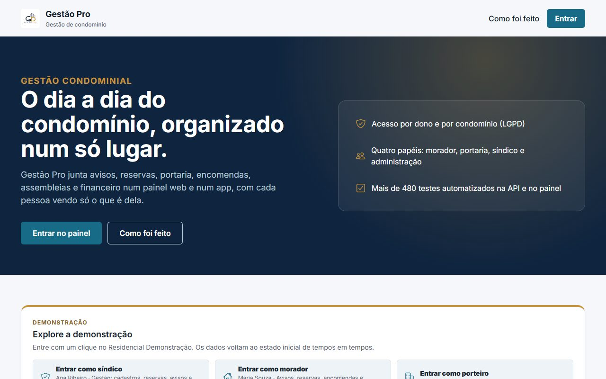
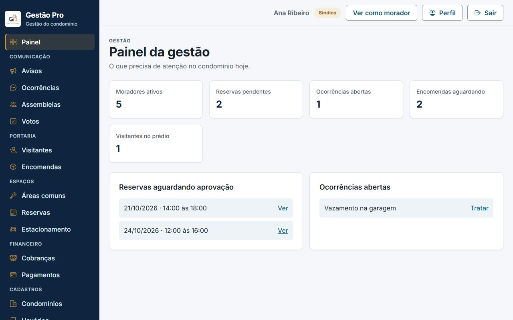
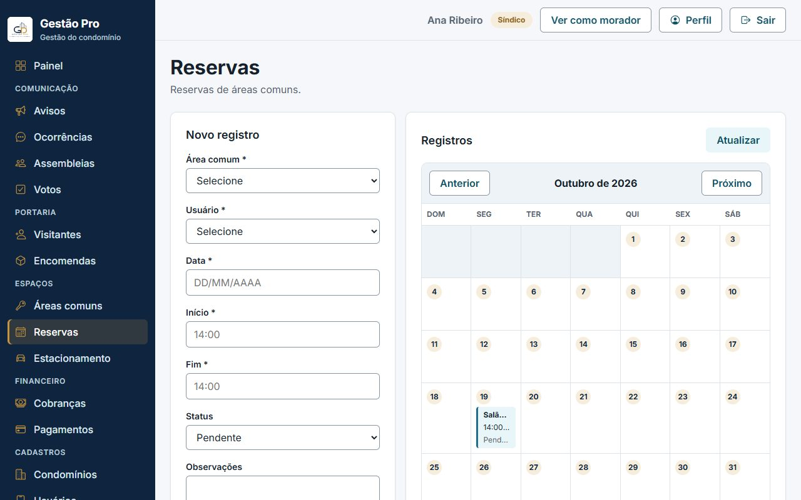
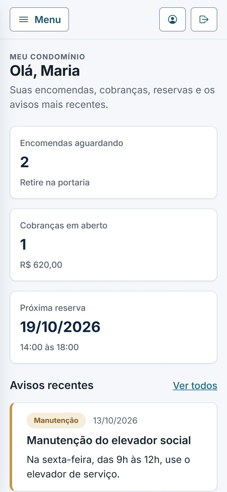
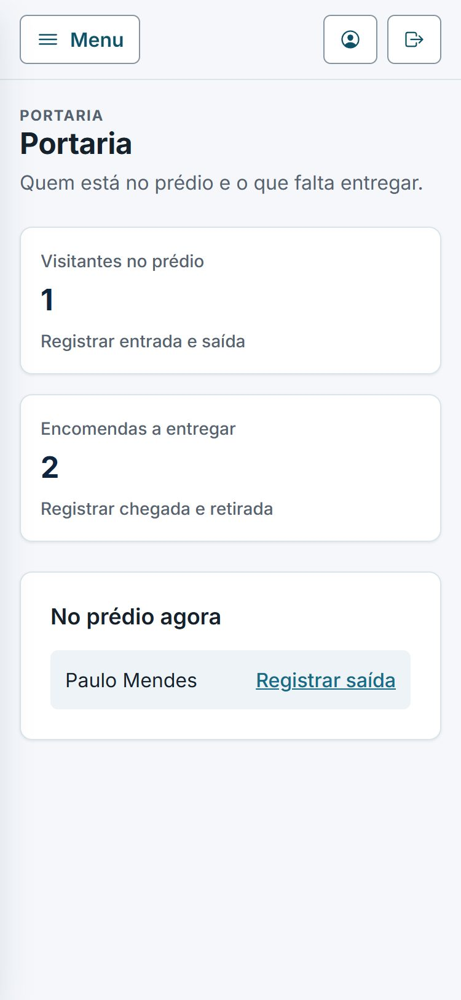
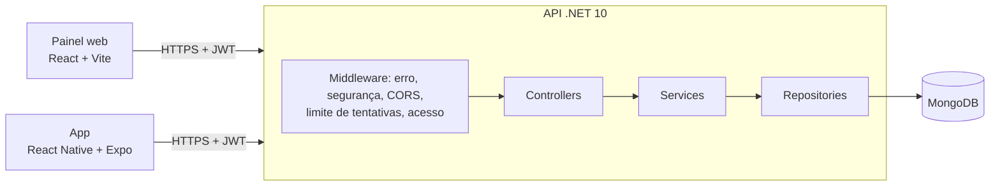
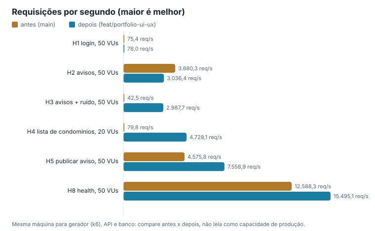

# Gestão Pro · gestão de condomínio

Avisos, reservas de áreas comuns, portaria, encomendas, assembleias e financeiro do condomínio num **painel web** e num **app**, com cada pessoa vendo só o que é dela.

| | |
|---|---|
| **Demonstração (painel)** | `https://gestaopro.vercel.app` *(link definitivo depois da publicação; ver [docs/deploy.md](docs/deploy.md))* |
| **Demonstração (app no navegador)** | `https://gestaopro-app.vercel.app` *(idem)* |
| **API** | `https://gestaopro-api-demo.onrender.com/api/demo` *(idem)* |
| **Como testar** | Abra o painel (ou o app) e clique em **Entrar como síndico**, **morador** ou **porteiro**: a sessão abre sem senha. Para testar a ativação de acesso, o cartão mostra o código do condomínio e os CPFs pré-cadastrados. |

> A API fica em hospedagem gratuita e dorme sem uso: a primeira resposta pode levar até 1 minuto (o painel avisa "Acordando o servidor de demonstração"). Os dados da demonstração voltam ao estado inicial a cada 90 minutos; quem estava dentro volta ao mesmo papel com um clique (ou sozinho, pelo cartão).



| Entrar (com a demonstração) | Painel da gestão | Reservas com calendário |
|---|---|---|
|  |  |  |

| Morador no celular | Portaria no celular | App: entrar | App: financeiro |
|---|---|---|---|
|  |  |  |  |

Prints reais, tirados no Chrome headless por `ferramentas/capturar-telas.mjs` (que também confere erro de console e rolagem horizontal).

## O que dá para fazer

| Papel | No painel e no app |
|---|---|
| **Morador** | Lê o mural de avisos; reserva áreas comuns (sem conflito de horário) e cancela as próprias; registra ocorrências; acompanha encomendas, visitantes, cobranças e pagamentos; vota nas assembleias; ativa o próprio acesso com CPF e o código do condomínio. |
| **Porteiro** | Registra visitantes, entrada e saída; registra a chegada e a retirada de encomendas. |
| **Síndico / administração** | Painel com o que precisa de atenção; aprova reservas; publica avisos; trata ocorrências; cria assembleias e pautas; lança cobranças e pagamentos; cadastra condomínio, unidades e pessoas; redefine senha. O síndico pode **ver como morador**. |

A API decide tudo pelo token: dados de outro condomínio respondem como inexistentes, e o morador só enxerga os próprios registros.

## Arquitetura

Monólito modular: uma API REST em **.NET 10** com **MongoDB**, servida a um painel em **React + TypeScript** e a um app em **React Native (Expo)**. Detalhes em [docs/05-Arquitetura da Solução](docs/05-Arquitetura%20da%20Solução.md).



**Decisões** ([docs/adr](docs/adr/README.md)): monólito modular em vez de microsserviços; acesso por dono e por condomínio decidido na API; modo demonstração por flag de servidor, sem credencial no código; trava por área e data contra reservas simultâneas; segredos fora do Git com precedência correta; hospedagem gratuita (Render, Vercel, Atlas).

**Segurança:** login com tempo de resposta igual para conta existente ou não, BCrypt, política de senha no servidor, limite de tentativas por IP e por condomínio com `Retry-After`, mensagens únicas nas rotas anônimas, isolamento por condomínio no banco, ProblemDetails sem detalhe interno, Swagger fechado em produção, CORS restrito e cabeçalhos de segurança.

**Identidade visual:** a partir da logo (marinho `#0E243F`, dourado `#C8953D`, teal `#176B87` para ações), fonte Inter, contraste AA conferido; mesmos tokens no painel e no app ([docs/06](docs/06-Template%20Padrão%20da%20Aplicação.md)).

## Qualidade

| Suíte | Testes | Comando |
|---|---|---|
| API (xUnit, unidade e integração) | 645 | `dotnet test src/GestaoPro.API.Tests` |
| Painel (Vitest + Testing Library) | 83 | `npm test` em `src/GestaoPro.Web` |
| App (Vitest) | 29 | `npm test` em `src/GestaoPro.Mobile` |

Lint (ESLint) sem avisos no painel e no app; GitHub Actions em [`.github/workflows/ci.yml`](.github/workflows/ci.yml).

## Teste de estresse

<!-- carga:inicio -->
Hipóteses escritas antes de medir ([hipóteses](docs/carga/2026-10-04-hipoteses.md)), depois medidas com k6 contra um banco descartável, comparando a `main` com esta versão ([resultados completos](docs/carga/2026-10-04-resultados.md)).

| Cenário (50 VUs, mesma máquina) | Antes | Depois |
|---|---:|---:|
| Avisos com 20 mil avisos de outro condomínio no banco | 43 req/s, p95 2,6 s | 2.988 req/s, p95 45 ms |
| Lista de condomínios do cadastro (20 VUs) | 80 req/s, p95 296 ms | 4.728 req/s, p95 10,5 ms |
| Publicar aviso | 4.576 req/s | 7.559 req/s |
| 50 reservas simultâneas no mesmo horário | 50 aceitas | 1 aceita, 49 recusadas |
| Login: e-mail inexistente x senha errada (mediana) | 9 ms x 114 ms (dá para descobrir contas) | 119 ms x 112 ms |

Também há o que piorou: a lista simples de avisos (100 avisos, sem outro condomínio) ficou de 19% a 32% mais lenta, e a causa provável está no banco, não na API. A remedição de 15/10, já com os tetos da demonstração pública, achou e corrigiu uma queda em "publicar aviso" e manteve as conclusões ([detalhes](docs/carga/2026-10-04-resultados.md#remedição-de-1510-tetos-da-demonstração-no-código)). Das 10 hipóteses, 8 se confirmaram e 2 só em parte (H4 e H8). O soak de 10 minutos a 1.500 req/s terminou sem erros e sem crescimento de memória.


<!-- carga:fim -->

## Limitações conhecidas

- Não há envio de e-mail: a recuperação de senha passa pela administração, que gera uma senha temporária (trocada no primeiro acesso).
- O token JWT fica no `localStorage` do painel e vale até expirar, mesmo depois de desativar a conta ([ADR 0003](docs/adr/0003-token-no-navegador.md)).
- Pagamentos são registro manual; não há boleto bancário nem gateway.
- Notificações em tempo real: o hub SignalR existe na API, mas os clientes ainda não exibem notificações.
- Calendário geral de eventos e atas de assembleia (RF-026 a RF-028) não foram implementados ([status dos requisitos](docs/02-Especificação%20do%20Projeto.md)).
- A instalação inicial (primeiro administrador num banco vazio) ainda é aceita sem login enquanto não existe administrador; numa instalação real, crie o administrador logo após subir a API.

## Roadmap

1. Cookie `httpOnly` e revogação de token.
2. Notificações no painel e push no app (SignalR e Expo Notifications).
3. Calendário de eventos e atas de assembleia.
4. Paginação nas demais listas (avisos já paginam) e contagem com limite no total de avisos (o teste de estresse mostrou o custo num condomínio com centenas de milhares de avisos).

## Rodar na sua máquina

Pré-requisitos: [.NET 10 SDK](https://dotnet.microsoft.com/download/dotnet/10.0), [Node.js 18+](https://nodejs.org/) e [Docker Desktop](https://www.docker.com/products/docker-desktop/).

```bat
iniciar.bat
```

O script confere os pré-requisitos, cria o `.env` com segredos aleatórios (fora do Git), sobe o MongoDB do `compose.yaml`, liga o modo demonstração local, espera a API responder e abre o painel em `http://localhost:3000`. Pode rodar de novo quantas vezes quiser. Para abrir também o app: `iniciar.bat app`. Para parar: feche as janelas e rode `docker compose stop`.

<details>
<summary>Configuração manual, variáveis e detalhes</summary>

| Variável | Para que serve |
|---|---|
| `MongoDbSettings__ConnectionString`, `MongoDbSettings__DatabaseName` | banco (sem eles a API não sobe e diz o que falta) |
| `JwtSettings__SecretKey` | assinatura do token (32+ caracteres) |
| `Demo__Enabled`, `Demo__CodigoCondominio`, `Demo__IntervaloResetMinutos` | modo demonstração (desligado por padrão; nunca ligue com dados reais). Tetos: `Demo__LimiteEscrita__PorUsuarioPorMinuto`, `__PorIpPorMinuto`, `Demo__LimitePorColecao` ([ADR 0004](docs/adr/0004-modo-demonstracao.md)) |
| `Cors__AllowedOrigins__0..n` | origens do painel e do app permitidas (em desenvolvimento valem as portas locais) |
| `Proxy__ConfiarNoProxy` | `true` atrás de proxy (Render) para o limite de tentativas usar o IP real |
| `RateLimiting__Auth__PermitLimit`, `__PerCondominiumPermitLimit`, `__WindowSeconds` | limites das rotas de autenticação (padrão 10/min por IP, 30/min por condomínio) |
| `VITE_API_BASE_URL` (painel), `EXPO_PUBLIC_API_URL` (app) | endereço da API quando hospedados |

Precedência: `appsettings.json` < `appsettings.{Ambiente}.json` < `appsettings.Local.json` (opcional, fora do Git) < variáveis de ambiente < linha de comando.

Manual: `dotnet run` em `src/GestaoPro.API` (com as variáveis acima), `npm install` e `npm run dev` em `src/GestaoPro.Web` (proxy para `http://localhost:5088`) e `npx expo start` em `src/GestaoPro.Mobile` (no celular, `EXPO_PUBLIC_API_URL` com o IP do PC na rede). Publicação: [docs/deploy.md](docs/deploy.md).

</details>

## Créditos

Projeto do curso de Análise e Desenvolvimento de Sistemas da PUC Minas, eixo 4 (Arquitetura de Sistemas Distribuídos), 2026/1: Deuslano Veloso de Oliveira Junior, Gustavo Marques Pereira e **Jefferson Luiz Mendonça da Silva**; orientação de Leonardo Vilela Cardoso. A revisão para portfólio (acesso por condomínio, segurança, painel reorganizado, identidade visual, modo demonstração, documentação e teste de estresse) é de Jefferson.

Documentação acadêmica: [contexto](docs/01-Documentação%20de%20Contexto.md) · [especificação](docs/02-Especificação%20do%20Projeto.md) · [metodologia](docs/03-Metodologia.md) · [interface](docs/04-Projeto%20de%20Interface.md) · [arquitetura](docs/05-Arquitetura%20da%20Solução.md) · [template](docs/06-Template%20Padrão%20da%20Aplicação.md) · [funcionalidades](docs/07-Programação%20de%20Funcionalidades.md) · [testes unitários](docs/08-Registro%20de%20Testes%20Unitários.md) · [integração](docs/09-Registro%20de%20Testes%20de%20Integração.md) · [sistema](docs/10-Registro%20de%20Testes%20de%20Sistema.md) · [contribuição](docs/11-Registro%20de%20Contribuição.md) · [apresentação](docs/12-Apresentação%20do%20Projeto.md) ([PDF](presentation/GestaoPro_Apresentacao.pdf)) · [referências](docs/13-Referências.md). Licença Apache 2.0.
