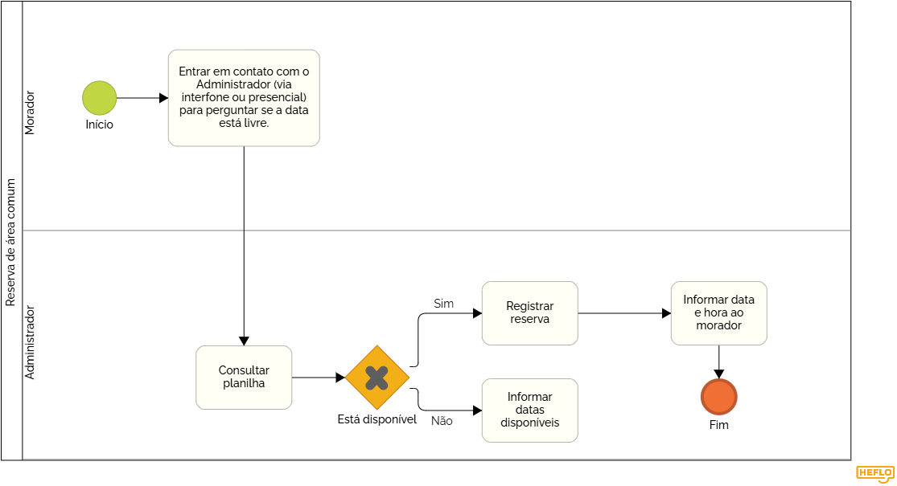
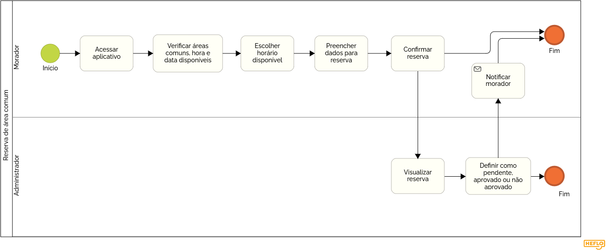
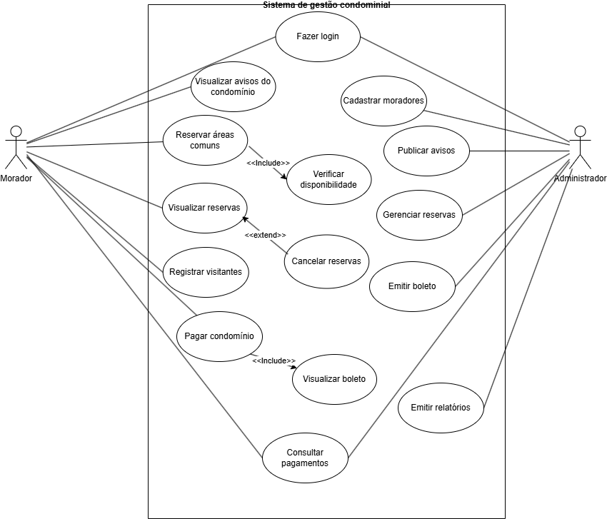
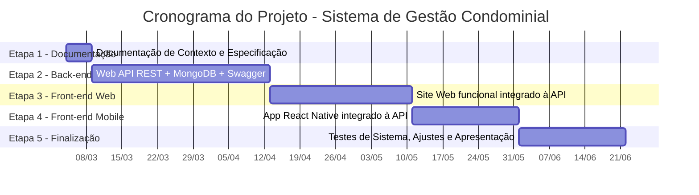

# Especificações do Projeto

Esta seção apresenta a definição do problema e a proposta de solução a partir da perspectiva dos usuários que interagem com o sistema de gestão de condomínio. Para isso, são utilizados diferentes artefatos de engenharia de requisitos que auxiliam na compreensão das necessidades dos usuários e na definição do escopo do projeto.

Inicialmente, são apresentadas as personas, que representam perfis de usuários que podem utilizar a aplicação e ajudam a compreender suas necessidades e dificuldades. Em seguida, são descritas as histórias de usuário, que expressam as funcionalidades esperadas do sistema sob a perspectiva desses usuários.

A partir dessas histórias e da análise dos processos do sistema por meio da modelagem BPMN (Business Process Model and Notation), são definidos os requisitos funcionais e não funcionais, que detalham respectivamente as funcionalidades da aplicação e suas características de qualidade. Também são apresentadas as restrições do projeto, que representam limitações consideradas durante o desenvolvimento.

Para apoiar a organização e priorização das funcionalidades, foi aplicada a técnica MoSCoW, utilizada para classificar os requisitos de acordo com seu nível de prioridade no sistema.

Além disso, esta seção inclui o diagrama de casos de uso, utilizado para representar graficamente as interações entre os usuários e o sistema, bem como a matriz de rastreabilidade de requisitos, que permite relacionar requisitos, histórias de usuário e funcionalidades do sistema.

Por fim, são apresentados os elementos de gestão de tempo do projeto, incluindo o cronograma de etapas, o diagrama de Gantt e a distribuição de tarefas entre os integrantes da equipe, que auxiliam no planejamento e acompanhamento das atividades de desenvolvimento.

## Personas
### Persona 1 – João Carlos Ferreira (Morador)

  

**Idade:** 34 anos  
**Profissão:** Analista administrativo  
**Localização:** Belo Horizonte – MG  
**Perfil tecnológico:** Usuário frequente de smartphone e aplicativos de serviços.

**Contexto:** 
João mora em um condomínio de médio porte e possui uma rotina de trabalho intensa. Muitas vezes ele chega em casa apenas à noite e não tem tempo para acompanhar avisos físicos fixados no prédio ou participar de conversas frequentes em grupos de mensagens do condomínio. Informações importantes, como avisos de manutenção, eventos ou mudanças nas regras de uso das áreas comuns, acabam se perdendo em meio a diversas mensagens informais.

Além disso, quando deseja utilizar espaços como o salão de festas ou churrasqueira, João precisa consultar o síndico ou verificar manualmente um quadro de reservas no condomínio. Esse processo pode gerar conflitos de horário ou incertezas sobre a disponibilidade dos espaços. Os horários de João o impossibilita de registar solicitações em tempo comercial com o síndico e João não está em casa na maior parte do dia para ser notificado via interfone que suas encomendas estão aguardando retirada na portaria. Essa falta de organização e centralização das informações gera frustração e perda de tempo.

**Objetivo:** 
Conseguir acompanhar facilmente avisos do condomínio e reservar áreas comuns de forma simples e organizada.

**Necessidades:** 
- Acessar avisos e comunicados do condomínio com facilidade.
- Reservar áreas comuns sem conflitos de horário.
- Consultar informações importantes do condomínio rapidamente.

### Persona 2 – Maria Aparecida Santos (Síndica)

  

**Idade:** 39 anos 
**Profissão:** Síndica do condomínio 
**Localização:** Recife – PE 
**Perfil tecnológico:** Utiliza smartphone e computador para tarefas administrativas básicas.

**Contexto:** 
Maria é síndica do condomínio onde mora e precisa lidar diariamente com diversas demandas administrativas. Ela precisa comunicar avisos importantes aos moradores, organizar reuniões, responder dúvidas e registrar solicitações relacionadas ao funcionamento do condomínio.

Atualmente, grande parte dessa comunicação ocorre por meio de grupos de mensagens ou avisos físicos no prédio. Esse modelo gera vários problemas: alguns moradores não visualizam os avisos, mensagens importantes se perdem entre outras conversas e Maria acaba recebendo repetidamente as mesmas dúvidas de diferentes moradores. Além disso, o controle de solicitações e atividades administrativas costuma ser feito de forma manual, dificultando a organização das informações.

**Objetivo:** 
Organizar a comunicação com os moradores e melhorar o controle das atividades administrativas do condomínio.

**Necessidades:** 
- Divulgar avisos importantes de forma clara para todos os moradores.
- Acompanhar solicitações feitas pelos moradores.
- Manter registros organizados das atividades do condomínio.

### Persona 3 – Lucas Henrique Almeida (Administrador de Condomínio)

  

**Idade:** 50 anos 
**Profissão:** Administrador de condomínios 
**Localização:** São Paulo – SP 
**Perfil tecnológico:** Alta familiaridade com sistemas digitais.

**Contexto:** 
Lucas trabalha prestando suporte administrativo para condomínios e precisa acompanhar diversas informações relacionadas à gestão desses ambientes. Muitas vezes, cada condomínio utiliza métodos diferentes para registrar informações, como planilhas, documentos separados ou comunicação por aplicativos de mensagens.

Essa falta de padronização dificulta o acompanhamento das atividades administrativas, tornando mais difícil localizar informações, acompanhar solicitações de moradores ou organizar registros importantes. Além disso, a ausência de uma ferramenta centralizada pode gerar retrabalho e perda de tempo na gestão das atividades.

**Objetivo:** 
Centralizar informações administrativas do condomínio em um único sistema para facilitar a gestão e o acompanhamento das atividades.

**Necessidades:** 
- Gerenciar moradores, reservas e registros administrativos.
- Acompanhar solicitações e atividades do condomínio.
- Consultar informações de forma rápida e organizada.

### Persona 4 – Dona Tereza Oliveira (Moradora Idosa)

  

**Idade:** 68 anos 
**Profissão:** Aposentada 
**Localização:** Campinas – SP 
**Perfil tecnológico:** Uso básico de smartphone.

**Contexto:** 
Dona Tereza mora no condomínio há muitos anos e valoriza muito a convivência com os vizinhos e a organização do ambiente onde vive. Entretanto, ela nem sempre consegue acompanhar todos os avisos divulgados pela administração e por isso não consegue participar de reuniões e de decisões coletivas, principalmente quando as informações são compartilhadas apenas em grupos de mensagens ou em murais físicos do condomínio.

Além disso, alguns sistemas digitais podem ser difíceis de utilizar devido a interfaces complexas, excesso de informações ou textos muito pequenos. Isso pode fazer com que ela dependa de outras pessoas para acessar informações importantes, o que reduz sua autonomia.

**Objetivo:** 
Conseguir acompanhar informações importantes do condomínio de maneira simples, clara e acessível, incluíndo calendário de eventos.

**Necessidades:** 
- Visualizar avisos importantes do condomínio.
- Saber quando ocorrerão eventos ou reuniões.
- Ter acesso simples às informações do condomínio.

### Persona 5 – Rafael Gomes da Silva (Porteiro)

  

**Idade:** 47 anos 
**Profissão:** Porteiro do condomínio 
**Localização:** Curitiba – PR 
**Perfil tecnológico:** Uso moderado de tecnologia no ambiente de trabalho.

**Contexto:** 
Rafael trabalha na portaria do condomínio e é responsável por controlar a entrada de visitantes, receber encomendas e orientar moradores. Atualmente, muitos desses registros são feitos manualmente em cadernos ou planilhas simples, o que pode dificultar a consulta posterior das informações.

Quando chegam visitantes ou entregas, Rafael precisa informar os moradores por telefone ou mensagens, o que nem sempre é rápido ou eficiente. Em horários de maior movimento, como no período da noite, esse processo pode gerar atrasos ou dificuldades para organizar os registros de forma adequada.

**Objetivo:** 
Registrar visitantes e entregas de forma rápida e organizada, facilitando a comunicação com os moradores e a organização das informações.

**Necessidades:** 
- Registrar visitantes ou entregas com agilidade.
- Consultar informações básicas dos moradores.
- Informar moradores sobre chegada de visitantes ou encomendas.

## Histórias de Usuários

Com base na análise das personas e em seus contextos de uso, foram identificadas as seguintes histórias de usuário para orientar o levantamento dos requisitos do sistema. As histórias foram agrupadas por contexto de uso para facilitar a compreensão das funcionalidades esperadas da aplicação.

### Comunicação e Informações do Condomínio

| EU COMO... PERSONA | QUERO/PRECISO ... FUNCIONALIDADE | PARA ... MOTIVO/VALOR |
| --- | --- | --- |
| Morador (João) | Visualizar avisos e comunicados do condomínio | Me manter informado sobre acontecimentos importantes |
| Morador (Dona Tereza) | Receber avisos de forma clara e organizada | Conseguir acompanhar informações importantes do condomínio |
| Síndica (Maria) | Publicar avisos e comunicados para os moradores | Informar todos sobre decisões e acontecimentos do condomínio |

### Reservas de Áreas Comuns

| EU COMO... PERSONA | QUERO/PRECISO ... FUNCIONALIDADE | PARA ... MOTIVO/VALOR |
| --- | --- | --- |
| Morador (João) | Reservar áreas comuns do condomínio | Utilizar espaços como salão de festas sem conflitos de horário |
| Administrador (Lucas) | Gerenciar reservas realizadas pelos moradores | Garantir organização no uso das áreas comuns |

### Gestão Administrativa do Condomínio

| EU COMO... PERSONA | QUERO/PRECISO ... FUNCIONALIDADE | PARA ... MOTIVO/VALOR |
| --- | --- | --- |
| Administrador (Lucas) | Cadastrar moradores no sistema | Manter o controle das pessoas que utilizam o condomínio |
| Síndica (Maria) | Acompanhar solicitações feitas pelos moradores | Resolver problemas e demandas do condomínio |
| Administrador (Lucas) | Gerenciar vagas de estacionamento de visitantes | Organizar o uso das vagas disponíveis |

### Solicitações e Ocorrências

| EU COMO... PERSONA | QUERO/PRECISO ... FUNCIONALIDADE | PARA ... MOTIVO/VALOR |
| --- | --- | --- |
| Morador (João) | Registrar solicitações ou ocorrências | Informar problemas ou necessidades do condomínio |
| Síndica (Maria) | Visualizar e acompanhar solicitações dos moradores | Resolver problemas reportados |
| Administrador (Lucas) | Registrar atualizações sobre solicitações de manutenção | Manter histórico e controle das ações realizadas |

### Visitantes e Encomendas

| EU COMO... PERSONA | QUERO/PRECISO ... FUNCIONALIDADE | PARA ... MOTIVO/VALOR |
| --- | --- | --- |
| Porteiro (Rafael) | Registrar visitantes que chegam ao condomínio | Manter controle de acesso de pessoas |
| Porteiro (Rafael) | Registrar encomendas recebidas | Organizar entregas destinadas aos moradores |
| Morador (João) | Visualizar quando uma encomenda chegou | Saber quando posso retirá-la |

### Assembleias e Eventos do Condomínio

| EU COMO... PERSONA | QUERO/PRECISO ... FUNCIONALIDADE | PARA ... MOTIVO/VALOR |
| --- | --- | --- |
| Síndica (Maria) | Criar assembleias virtuais | Organizar reuniões do condomínio |
| Morador (Dona Tereza) | Participar de votações em assembleias digitais | Opinar nas decisões do condomínio |
| Síndica (Maria) | Registrar atas das assembleias realizadas | Manter histórico das decisões tomadas |
| Morador (Dona Tereza) | Visualizar eventos no calendário do condomínio | Saber quando ocorrerão atividades ou reuniões |

### Cadastro de Informações Complementares

| EU COMO... PERSONA | QUERO/PRECISO ... FUNCIONALIDADE | PARA ... MOTIVO/VALOR |
| --- | --- | --- |
| Administrador (Lucas) | Cadastrar vagas de visitantes | Organizar o uso do estacionamento |
| Morador (Dona Tereza) | Visualizar vagas disponíveis | Saber quando posso utilizar uma vaga |
| Síndica (Maria) | Registrar pets associados às unidades | Manter controle das informações de moradores e animais |

## Requisitos

A identificação dos requisitos funcionais e não funcionais foi realizada a partir da análise dos processos de negócio modelados em BPMN, utilizando a abordagem BPMNFR para identificar necessidades funcionais e atributos de qualidade do sistema.

Após a identificação dos requisitos, foi aplicada a técnica de priorização **MoSCoW**, classificando os requisitos conforme seu nível de importância para o funcionamento da solução.

## Técnica de Priorização de Requisitos

Para definir a prioridade dos requisitos foi utilizada a técnica **MoSCoW**, que classifica os requisitos conforme sua importância para o funcionamento do sistema:

- **Alta (Must Have)** – Requisitos essenciais para o funcionamento da solução.
- **Média (Should Have)** – Requisitos importantes, mas não impedem o funcionamento básico do sistema.
- **Baixa (Could Have)** – Requisitos desejáveis que agregam valor, mas não são essenciais.

A priorização foi realizada considerando as necessidades identificadas no contexto do problema, especialmente relacionadas à comunicação entre moradores e administração, organização de informações do condomínio e gestão de recursos compartilhados.

# Requisitos Funcionais

| ID | Descrição do Requisito | Prioridade | Responsável |
| --- | --- | --- | --- |
| RF-001 | Permitir que administradores realizem cadastro de moradores no sistema | ALTA | Jefferson |
| RF-002 | Permitir o cadastro e consulta de informações gerais do condomínio (regras, regulamentos, etc.) | MÉDIA | Jefferson |
| RF-003 | Permitir que administradores realizem cadastro de outros administradores no sistema | ALTA | Jefferson |
| RF-004 | Permitir que moradores realizem login na plataforma utilizando matrícula fornecida pela administração e senha | ALTA | Jefferson |
| RF-005 | Permitir que administradores realizem login na plataforma utilizando e-mail e senha | ALTA | Jefferson |
| RF-006 | Permitir que o administrador possa definir papel de morador ou administrador ao usuário cadastrado | ALTA | Jefferson |
| RF-007 | Permitir que moradores realizem reservas de áreas comuns do condomínio | ALTA | Jefferson |
| RF-008 | Permitir que administradores visualizem e gerenciem reservas de áreas comuns realizadas | ALTA | Jefferson |
| RF-009 | Permitir que moradores visualizem o calendário de reservas de áreas comuns | MÉDIA | Jefferson |
| RF-010 | Permitir que administradores publiquem avisos e comunicados do condomínio | MÉDIA | Jefferson |
| RF-011 | Permitir que moradores recebam notificações sobre novos avisos ou eventos | MÉDIA | Jefferson |
| RF-012 | Permitir que moradores visualizem avisos e comunicados publicados pela administração | MÉDIA | Jefferson |
| RF-013 | Permitir que moradores registrem solicitações ou ocorrências relacionadas ao condomínio | MÉDIA | Deuslano |
| RF-014 | Permitir que administradores acompanhem e gerenciem solicitações e ocorrências realizadas por moradores | MÉDIA | Deuslano |
| RF-015 | Permitir que moradores consultem suas solicitações e ocorrências e seu status | BAIXA | Deuslano |
| RF-016 | Permitir que administradores cadastrem vagas de estacionamento destinadas ao uso comum ou visitantes | ALTA | Deuslano |
| RF-017 | Permitir que moradores visualizem vagas de estacionamento disponíveis para uso temporário | MÉDIA | Deuslano |
| RF-018 | Permitir que moradores reservem vagas de estacionamento disponíveis para visitantes ou uso compartilhado | MÉDIA | Deuslano |
| RF-019 | Permitir que administradores acompanhem e gerenciem a ocupação das vagas de visitantes | MÉDIA | Deuslano |
| RF-020 | Permitir que administradores registrem encomendas ou correspondências recebidas para moradores | MÉDIA | Deuslano |
| RF-021 | Permitir que moradores visualizem e confirmem a retirada de encomendas ou correspondências | MÉDIA | Deuslano |
| RF-022 | Permitir que administradores cadastrem visitantes associados a moradores ou unidades | MÉDIA | Deuslano |
| RF-023 | Permitir o registro de entrada e saída de visitantes no condomínio | ALTA | Deuslano |
| RF-024 | Permitir que administradores criem assembleias virtuais e votações para discussão de assuntos do condomínio | BAIXA | Gustavo |
| RF-025 | Permitir que moradores participem de votações em assembleias digitais | BAIXA | Gustavo |
| RF-026 | Permitir o registro das atas das assembleias realizadas dentro da sessão de assembleia digital | BAIXA | Gustavo |
| RF-027 | Permitir que administradores registrem eventos ou compromissos no calendário geral do condomínio | BAIXA | Jefferson |
| RF-028 | Permitir que moradores visualizem o calendário geral do condomínio com eventos e atividades | BAIXA | Jefferson |
| RF-029 | Permitir que administradores cadastrem pets associados aos moradores e às suas respectivas unidades (apartamentos ou casas) | BAIXA | Deuslano |
| RF-030 | Permitir que moradores visualizem os pets cadastrados associados à sua unidade | BAIXA | Deuslano |
| RF-031 | Permitir que o administrador cadastre cobranças e envie boletos de cobrança para as unidades do condomínio | ALTA | Gustavo |
| RF-032 | Permitir que o morador visualize os boletos disponíveis para sua unidade | ALTA | Gustavo |
| RF-033 | Permitir que o morador realize o pagamento de boletos do condomínio por meio de registro manual de pagamento | MÉDIA | Gustavo |
| RF-034 | Permitir que o morador consulte o histórico de pagamentos realizados | MÉDIA | Gustavo |
| RF-035 | Permitir que o administrador consulte os pagamentos realizados por unidade ou período | MÉDIA | Gustavo |

# Requisitos Não Funcionais

| ID | Descrição do Requisito | Prioridade |
| --- | --- | --- |
| RNF-001 | O sistema deve ser responsivo, permitindo uso adequado em computadores, tablets e smartphones | ALTA |
| RNF-002 | O sistema deve possuir autenticação segura baseada em matrícula e senha para acesso dos usuários | ALTA |
| RNF-003 | O sistema deve processar requisições do usuário em até 3 segundos em condições normais de uso | MÉDIA |
| RNF-004 | A interface do sistema deve seguir princípios de usabilidade e acessibilidade digital | MÉDIA |
| RNF-005 | O sistema deve garantir armazenamento seguro das informações dos usuários | ALTA |
| RNF-006 | O sistema deve permitir acesso tanto por navegador web quanto por aplicativo mobile | ALTA |

# Restrições do Sistema

| ID | Descrição da Restrição |
| --- | --- |
| RST-001 | O sistema deverá ser desenvolvido utilizando tecnologias compatíveis com aplicações web e mobile definidas pelo grupo. |
| RST-002 | O desenvolvimento do projeto deverá ser realizado dentro do período acadêmico estabelecido pela disciplina. |
| RST-003 | O sistema deverá seguir as diretrizes e critérios de avaliação definidos pelo professor da disciplina. |

## Modelagem BPMN

O processo atual baseia-se na comunicação verbal e no registro físico. O morador entra em contato com o administrador para perguntar se uma data específica está livre. O administrador consulta manualmente uma planilha e, caso esteja disponível, registra a reserva no livro e informa o morador. Se a data estiver ocupada, o administrador informa manualmente as opções restantes ao morador.

A proposta consiste na criação de uma aplicação móvel voltada para a gestão condominial, integrando Moradores e Administradores. A aplicação permitirá a realização de reservas de áreas comuns de forma autônoma. Assim, o morador pode escolher horários disponíveis e preencher os dados necessários diretamente na plataforma. O administrador, por sua vez, pode gerenciar as solicitações através de um painel de controle, definindo os status como pendente, aprovado ou não aprovado.

## Diagrama de Casos de Uso

---

## Matriz de Rastreabilidade 

| RF \ RNF | RNF-001 | RNF-002 | RNF-003 | RNF-004 | RNF-005 | RNF-006 | 
|-----------|---------|---------|---------|---------|---------|---------|
| **RF-001**  |   | x | x | x | x | x |
| **RF-002**  |  | x | x | x | x |   |
| **RF-003**  | x | x | x | x | x | x |
| **RF-004**  | x |   | x | x |   | x |
| **RF-005**  | x |   | x | x |   | x |
| **RF-006**  | x | x | x | x |   | x |
| **RF-007**  | x | x | x | x | x | x |
| **RF-008**  | x |  | x | x |  | x |
| **RF-009**  | x |  | x | x |  | x |
| **RF-010**  | x |  | x | x |  | x |
| **RF-011**  | x |  | x | x |  | x |
| **RF-012**  | x | x | x | x | x | x |
| **RF-013**  | x | x | x | x | x | x |
| **RF-014**  | x | x | x | x |  | x |
| **RF-015**  | x | x | x | x |  | x |
| **RF-016**  | x |   | x | x |   | x |
| **RF-017**  | x |   | x | x |   | x |
| **RF-018**  | x | x | x | x | x | x |
| **RF-019**  |  | x | x | x | x |  |
| **RF-020**  | x | x | x | x |  | x |
| **RF-021**  |  | x | x | x | x |  |
| **RF-022**  |  | x | x | x | x |  |
| **RF-023**  | x | x | x | x |  | x |
| **RF-024**  | x | x | x | x |  | x |
| **RF-025**  | x | x | x | x | x | x |
| **RF-026**  | x |   | x | x |   | x |
| **RF-027**  | x |   | x | x |   | x |
| **RF-028**  | x | x | x | x | x | x |
| **RF-029**  | x | x | x | x | x | x |
| **RF-030**  |  | x | x | x | x |  |
| **RF-031**  | x |  | x | x |  | x |

##
A matriz de rastreabilidade apresentada relaciona os requisitos funcionais do sistema com os requisitos não funcionais definidos, permitindo identificar quais características de qualidade são atendidas por cada funcionalidade do sistema.

# Gerenciamento de Projeto

De acordo com o PMBoK v6 as dez áreas que constituem os pilares para gerenciar projetos, e que caracterizam a multidisciplinaridade envolvida, são: Integração, Escopo, Cronograma (Tempo), Custos, Qualidade, Recursos, Comunicações, Riscos, Aquisições, Partes Interessadas. Para desenvolver projetos um profissional deve se preocupar em gerenciar todas essas dez áreas. Elas se complementam e se relacionam, de tal forma que não se deve apenas examinar uma área de forma estanque. É preciso considerar, por exemplo, que as áreas de Escopo, Cronograma e Custos estão muito relacionadas. Assim, se eu amplio o escopo de um projeto eu posso afetar seu cronograma e seus custos.

## Gerenciamento de Tempo

O projeto será desenvolvido utilizando a metodologia ágil Kanban, organizado em 5 etapas, com início em 04/03/2026 e entrega final em 21/06/2026. As tecnologias utilizadas serão: Node.js/Express, MongoDB, HTML/CSS, React Native, ASP.NET, Azure e JavaScript. O cronograma abaixo apresenta o planejamento das etapas com seus respectivos entregáveis de software e documentação.

### Cronograma de Etapas

| Etapa | Período | Foco Principal | Software Entregável | Docs Preenchidos |
|-------|---------|----------------|--------------------|--------------------|
| Etapa 1 | 04/03 – 08/03/2026 | Documentação de Contexto e Especificação | — | 01, 02, 05 |
| Etapa 2 | 09/03 – 12/04/2026 | Backend: API REST + MongoDB | API funcional com Swagger | 05 (atualizar) |
| Etapa 3 | 13/04 – 10/05/2026 | Frontend Web integrado à API | Site web funcional | 06, 07, 08 |
| Etapa 4 | 11/05 – 31/05/2026 | Frontend Mobile integrado | App React Native | 07 (atualizar), 09 |
| Etapa 5 | 01/06 – 21/06/2026 | Finalização, testes e apresentação | Sistema completo | 03, 04, 10, 11, 12, 13 |

### Diagrama de Gantt

## Gerenciamento de Equipe

O gerenciamento adequado de tarefas contribuirá para que o projeto alcance altos níveis de produtividade. Por isso, é fundamental que ocorra a gestão de tarefas e de pessoas, de modo que os times envolvidos no projeto possam ser facilmente gerenciados.

### Distribuição de Tarefas por Etapa

**Etapa 1 — Documentação de Contexto e Especificação do Projeto (04/03 – 08/03/2026)**

| Atividade | Responsável(is) |
|-----------|-----------------|
| Personas e Histórias de Usuários | Jefferson |
| Requisitos Funcionais e Não Funcionais, Restrições | Jefferson |
| Diagrama de Casos de Uso | Jefferson |
| Planejamento de Cronograma, Custos e Pessoal do Projeto | Jefferson |
| Definição e Documentação da Arquitetura Distribuída do Projeto | Gustavo |
| Diagrama de Classes | Deuslano |

**Etapa 2 — Desenvolvimento do Back-end (09/03 – 12/04/2026)**

| Atividade | Responsável(is) |
|-----------|-----------------|
| Configuração do ambiente e estrutura do projeto (ASP.NET Core) | Jefferson |
| Modelagem de dados no MongoDB (users, announcements, reservations, commonAreas, payments, visitors) | Gustavo |
| Implementação de autenticação e autorização JWT (login — Morador e Administrador) | Jefferson |
| Endpoints de avisos: publicar e visualizar (RF-010, RF-012) | Jefferson |
| Endpoints de reservas: reservar, visualizar, cancelar, gerenciar (RF-007, RF-008, RF-009) | Jefferson |
| Endpoints de moradores: cadastrar e consultar (RF-001, RF-002, RF-003) | Jefferson |
| Endpoints de visitantes e encomendas: registrar entrada/saída (RF-020 a RF-023) | Deuslano |
| Endpoints de assembleias e votações (RF-024, RF-025, RF-026) | Gustavo |
| Endpoints de pagamentos: emitir boleto, pagar, consultar pagamentos (RF-031 a RF-035) | Gustavo |
| Endpoints de estacionamento e pets (RF-016 a RF-019, RF-029, RF-030) | Deuslano |
| Documentação da API com Swagger | Jefferson |
| Atualização da Arquitetura da Solução (Doc 05) | Deuslano e Gustavo |
| Gestão do quadro de trabalho no GitHub | Jefferson |

**Etapa 3 — Desenvolvimento Web (13/04 – 10/05/2026)**

As telas a seguir estão alinhadas com o Diagrama de Casos de Uso do sistema, cobrindo as interações dos atores **Morador** e **Administrador**.

| Atividade | Funcionalidade | Responsável(is) |
| --- | --- | --- |
| Tela de Autenticação, Acesso ao Sistema e Permissões (Login, Logout, Cadastro) | Autenticação e Acesso ao Sistema | Jefferson |
| Tela de Gerenciamento de Perfis de Administradores e Moradores (Cadastro e Visualização de Usuários) | Gestão de Administradores e Moradores | Jefferson |
| Tela de Gerenciamento de Avisos e Notificações (Inclusão de Avisos e Disparo de Notificações) | Gestão de Avisos e Notificações | Jefferson |
| Tela de Gerenciamento de Calendário do Condomínio (Inclusão de Eventos e Disparo de Notificações) | Calendário do Condomínio | Jefferson |
| Tela de Gestão e Reserva de Áreas Comuns (Cadastro de Áreas Comuns e Gerenciamento de Reservas) | Gestão e Reserva de Áreas Comuns | Jefferson |
| Tela de Gerenciamento de Pets (Cadastro e Visualização de Pets) | Gestão de Pets | Deuslano |
| Tela de Gerenciamento de Encomendas e Correspondência (Cadastro e Notificação ao Morador) | Gestão de Encomendas e Correspondência | Deuslano |
| Tela de Gerenciamento de Solicitações de Manutenção e Ocorrências | Solicitações e Ocorrências | Deuslano |
| Tela de Gestão e Reserva de Vagas de Estacionamento | Gestão e Reserva de Vagas de Estacionamento | Deuslano |
| Tela de Registro e Controle de Visitantes | Registro e Controle de Visitantes | Deuslano |
| Tela de Gerenciamento de Assembleias e Votações (Chat e Enquetes) | Assembleias e Votações Digitais | Gustavo |
| Tela de Gerenciamento Financeiro (Cobrança e Histórico) | Gestão Financeira e Pagamentos | Gustavo |
| Elaboração e Registro de Testes Unitários | | Deuslano e Gustavo |
| Gestão do Quadro Kanban no Project | | Jefferson |

**Etapa 4 — Desenvolvimento Mobile (11/05 – 31/05/2026)**

As telas mobile seguem os mesmos casos de uso do Diagrama, priorizando a experiência do **Morador** via React Native.

| Atividade | Funcionalidade | Responsável(is) |
| --- | --- | --- |
| Telas de Acesso ao Sistema (Login, Cadastro, Logout) | Autenticação e Acesso ao Sistema | Jefferson |
| Tela de Visualização de Avisos e Notificações | Gestão de Avisos e Notificações | Jefferson |
| Tela de Visualização de Calendário do Condomínio | Calendário do Condomínio | Jefferson |
| Tela de Reserva de Áreas Comuns (Listagem e Inclusão de Reserva) | Gestão e Reserva de Áreas Comuns | Jefferson |
| Tela de Visualização de Perfis e Home | Gestão de Moradores | Jefferson |
| Tela de Visualização de Encomendas e Correspondência | Gestão de Encomendas e Correspondência | Deuslano |
| Tela de Cadastro de Solicitações e Ocorrências | Solicitações e Ocorrências | Deuslano |
| Tela de Pets (Cadastro e Visualização) | Gestão de Pets | Deuslano |
| Tela de Visitantes (Cadastro e Controle) | Registro e Controle de Visitantes | Deuslano |
| Tela de Interação de Assembleias e Votações | Assembleias e Votações Digitais | Gustavo |
| Tela de Visualização Financeiro (Cobranças, Boletos e Histórico) | Gestão Financeira e Pagamentos | Gustavo |
| Gestão do Quadro Kanban no Project | | Jefferson |
| Elaboração e Registros de Testes de Integração | | Deuslano e Gustavo |

**Etapa 5 — Considerações Finais e Entrega (01/06 – 21/06/2026)**

| Atividade | Responsável(is) |
|-----------|-----------------|
| Avaliação dos frameworks e tecnologias utilizadas (Doc 12) | Deuslano e Jefferson |
| Análise crítica e proposta de melhorias (Doc 12) | Gustavo e Jefferson |
| Elaboração e registro de testes de sistema (Doc 10) | Deuslano e Gustavo |
| Registro de contribuição individual (Doc 11) | Todos |
| Preparação da apresentação final (Doc 12) | Todos |
| Revisão geral da documentação e entrega (Doc 13) | Todos |
| Gestão do quadro de trabalho no GitHub | Jefferson |

## Gerenciamento de Custos

Esta seção apresenta uma estimativa de custos para o desenvolvimento do Sistema de Gestão Condominial, simulando um cenário de mercado com desenvolvedores júnior contratados como PJ (Pessoa Jurídica), considerando valores compatíveis com a realidade do mercado de TI brasileiro em 2026.

### Premissas do Cálculo

- **Equipe:** 3 desenvolvedores júnior full-stack (regime PJ)
- **Duração total:** ~16 semanas (04/03 a 21/06/2026)
- **Dedicação estimada:** 20 horas/semana por desenvolvedor (regime parcial, compatível com vínculo acadêmico)
- **Remuneração de referência:** R$ 60,00/hora (faixa de mercado para desenvolvedor júnior PJ no Brasil em 2026, com base em pesquisas salariais de plataformas como Glassdoor, Programathor e GeekHunter)

> **Justificativa do valor/hora:** O salário médio de um desenvolvedor júnior CLT no Brasil em 2026 gira em torno de R$ 4.500 a R$ 6.000/mês para jornada integral (160h/mês), o que representa ~R$ 28 a R$ 37/hora em regime CLT. No regime PJ, considerando que o profissional arca com impostos (ISS, INSS, IR), plano de saúde, férias e 13º por conta própria, a prática de mercado aplica um multiplicador de 1,5x a 2x sobre o valor CLT, chegando a **R$ 50 a R$ 75/hora**. Adotamos R$ 60,00/hora como valor intermediário dessa faixa.

### Estimativa de Horas por Etapa

| Etapa | Duração | Horas/dev | Total (3 devs) | Custo Estimado |
|-------|---------|-----------|----------------|----------------|
| Etapa 1 — Documentação | 1 semana | 20h | 60h | R$ 3.600,00 |
| Etapa 2 — Back-end | 5 semanas | 100h | 300h | R$ 18.000,00 |
| Etapa 3 — Front-end Web | 4 semanas | 80h | 240h | R$ 14.400,00 |
| Etapa 4 — Front-end Mobile | 3 semanas | 60h | 180h | R$ 10.800,00 |
| Etapa 5 — Finalização | 3 semanas | 60h | 180h | R$ 10.800,00 |
| **Total de Mão de Obra** | **~16 sem.** | **320h** | **960h** | **R$ 57.600,00** |

### Estimativa de Custos de Infraestrutura

| Recurso | Plano | Custo Mensal | Custo Estimado (4 meses) |
|---------|-------|-------------|--------------------------|
| MongoDB Atlas (banco de dados em nuvem) | M10 (produção) | R$ 150,00/mês | R$ 600,00 |
| Hospedagem da API (Render — Starter) | Starter (~US$ 7/mês) | R$ 40,00/mês | R$ 160,00 |
| Hospedagem do Front-end Web (Vercel — Pro) | Pro (~US$ 20/mês) | R$ 110,00/mês | R$ 440,00 |
| Domínio personalizado (.com.br) | Registro.br | — | R$ 40,00/ano |
| Expo (build do aplicativo React Native) | Free tier | R$ 0,00 | R$ 0,00 |
| GitHub (repositório e CI/CD) | Free | R$ 0,00 | R$ 0,00 |
| Ferramentas de desenvolvimento (licenças IDE, Postman, etc.) | Gratuitas/Community | R$ 0,00 | R$ 0,00 |
| **Total de Infraestrutura** | | | **R$ 1.240,00** |

### Resumo dos Custos

| Item | Valor |
|------|-------|
| Mão de obra (3 devs júnior PJ × 320h × R$ 60,00/h) | R$ 57.600,00 |
| Infraestrutura (cloud, hospedagem e domínio) | R$ 1.240,00 |
| Reserva de contingência (10%) | R$ 5.884,00 |
| **Custo Total Estimado** | **R$ 64.724,00** |

### Detalhamento do Custo Mensal por Desenvolvedor

| Parâmetro | Valor |
|-----------|-------|
| Valor/hora (PJ) | R$ 60,00 |
| Horas/semana | 20h |
| Semanas/mês (~) | 4,3 semanas |
| **Custo mensal por desenvolvedor** | **R$ 5.160,00** |
| **Custo mensal da equipe (3 devs)** | **R$ 15.480,00** |

### Comparativo CLT vs. PJ

| Regime | Valor/hora | Custo mensal/dev (20h/sem) | Custo total equipe (16 sem.) | Observação |
|--------|-----------|---------------------------|------------------------------|-----------|
| CLT | ~R$ 35,00 | ~R$ 3.010,00 | ~R$ 36.120,00 | Empresa arca com encargos (~70% adicionais: FGTS, INSS patronal, férias, 13º) |
| PJ | R$ 60,00 | R$ 5.160,00 | R$ 57.600,00 | Profissional arca com impostos e benefícios próprios |

> **Observação:** Este projeto é desenvolvido em contexto acadêmico, portanto os custos acima representam uma **simulação de mercado** e não refletem remuneração efetiva dos integrantes. Os valores foram calculados com base em pesquisas salariais do mercado brasileiro de TI em 2026, considerando o regime PJ que é o mais comum para projetos de curta duração. Em um cenário CLT, o custo direto para o desenvolvedor seria menor, mas a empresa teria encargos adicionais de aproximadamente 70% sobre o salário bruto.

