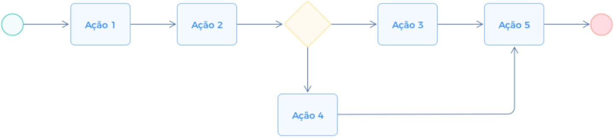
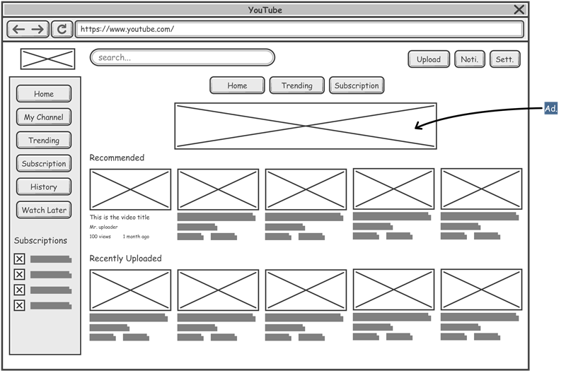

# Projeto de Interface

Pré-requisitos: <a href="2-Especificação do Projeto.md"> Documentação de Especificação</a>

Visão geral da interação do usuário pelas telas do sistema e protótipo interativo das telas com as funcionalidades que fazem parte do sistema (wireframes), tanto da versão web como para a versão mobile.

 Apresente as principais interfaces da plataforma. Discuta como ela foi elaborada de forma a atender os requisitos funcionais, não funcionais e histórias de usuário abordados nas <a href="2-Especificação do Projeto.md"> Documentação de Especificação</a>.

## Diagrama de Fluxo

O diagrama apresenta o estudo do fluxo de interação do usuário com o sistema interativo e  muitas vezes sem a necessidade do desenho do design das telas da interface. Isso permite que o design das interações seja bem planejado e gere impacto na qualidade no design do wireframe interativo que será desenvolvido logo em seguida.

O diagrama de fluxo pode ser desenvolvido com “boxes” que possuem internamente a indicação dos principais elementos de interface - tais como menus e acessos - e funcionalidades, tais como editar, pesquisar, filtrar, configurar - e a conexão entre esses boxes a partir do processo de interação. Você pode ver mais explicações e exemplos https://www.lucidchart.com/blog/how-to-make-a-user-flow-diagram.

As referências abaixo irão auxiliá-lo na geração do artefato “Diagramas de Fluxo”.

> **Links Úteis**:
> - [Fluxograma online: seis sites para fazer gráfico sem instalar nada | Produtividade | TechTudo](https://www.techtudo.com.br/listas/2019/03/fluxograma-online-seis-sites-para-fazer-grafico-sem-instalar-nada.ghtml)

## Wireframes

São protótipos usados em design de interface para sugerir a estrutura de um site web e seu relacionamentos entre suas páginas. Um wireframe web é uma ilustração semelhante do layout de elementos fundamentais na interface.
 
> **Links Úteis**:
> - [Protótipos vs Wireframes](https://www.nngroup.com/videos/prototypes-vs-wireframes-ux-projects/)
> - [Ferramentas de Wireframes](https://rockcontent.com/blog/wireframes/)
> - [MarvelApp](https://marvelapp.com/developers/documentation/tutorials/)
> - [Figma](https://www.figma.com/)
> - [Adobe XD](https://www.adobe.com/br/products/xd.html#scroll)
> - [Axure](https://www.axure.com/edu) (Licença Educacional)
> - [InvisionApp](https://www.invisionapp.com/) (Licença Educacional)

### Wireframes para Avisos (RF-004, RF-005)

#### Versão Web (React) - Publicar Aviso (Administrador)
- **Tela de Publicação de Aviso**: Formulário com campos para título, conteúdo, data de publicação, e botão "Publicar". Menu lateral com navegação para outras funcionalidades administrativas.

#### Versão Web (React) - Visualizar Avisos (Morador)
- **Tela de Lista de Avisos**: Lista de avisos com título, data, e resumo. Ao clicar, abre detalhes do aviso. Menu superior com filtros por data.

#### Versão Mobile (React Native) - Publicar Aviso (Administrador)
- **Tela de Publicação**: Formulário vertical com campos de entrada para título e conteúdo, seletor de data, botão flutuante para publicar. Bottom navigation para acesso rápido.

#### Versão Mobile (React Native) - Visualizar Avisos (Morador)
- **Tela de Feed de Avisos**: Scrollable list com cards de avisos, mostrando título, data e ícone. Pull-to-refresh para atualizar. Tab bar inferior para navegação.

### Wireframes para Reservas (RF-006, RF-007, RF-009)

#### Versão Web (React) - Reservar Área Comum (Morador)
- **Tela de Reserva**: Formulário com dropdown para seleção de área comum, calendário para data, seletor de horário, botão "Reservar". Sidebar com lista de reservas existentes.

#### Versão Web (React) - Visualizar e Gerenciar Reservas (Administrador)
- **Tela de Gerenciamento**: Tabela com todas as reservas, colunas para morador, área, data, status. Botões para aprovar/rejeitar/editar. Filtros por status e data.

#### Versão Web (React) - Visualizar Calendário de Reservas (Morador)
- **Tela de Calendário**: Calendário mensal com reservas marcadas. Ao clicar em uma data, mostra detalhes das reservas. Navegação por mês.

#### Versão Mobile (React Native) - Reservar Área Comum (Morador)
- **Tela de Reserva**: Campos de seleção para área, data (datepicker), horário (time picker), botão "Reservar". Drawer para ver reservas próprias.

#### Versão Mobile (React Native) - Visualizar Calendário (Morador)
- **Tela de Calendário**: Calendário com dias marcados. Lista abaixo com reservas do dia selecionado. Swipe para navegar meses.

#### Versão Mobile (React Native) - Gerenciar Reservas (Administrador)
- **Tela de Lista**: Lista de reservas com status, ações de swipe para aprovar/rejeitar. Filtros por área e data. Bottom sheet para detalhes.
