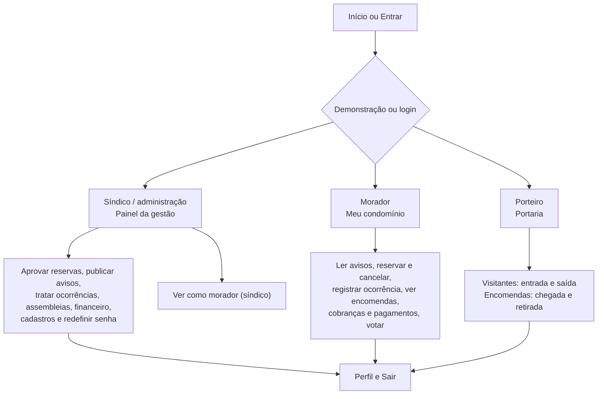
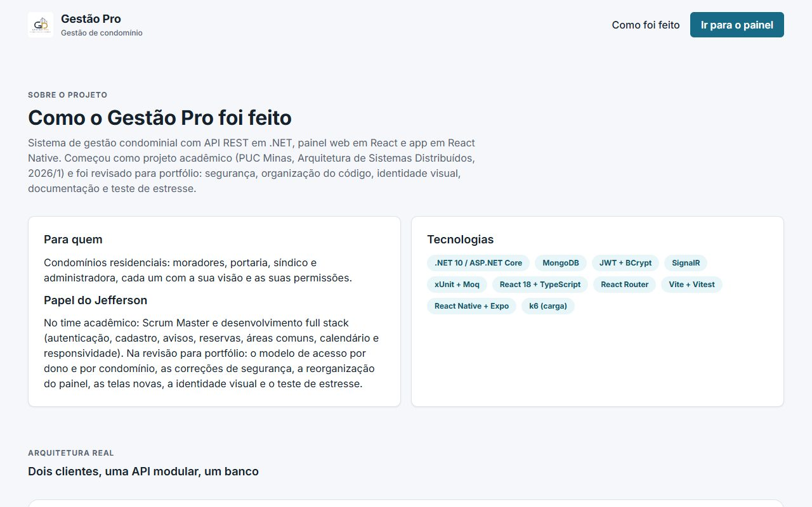
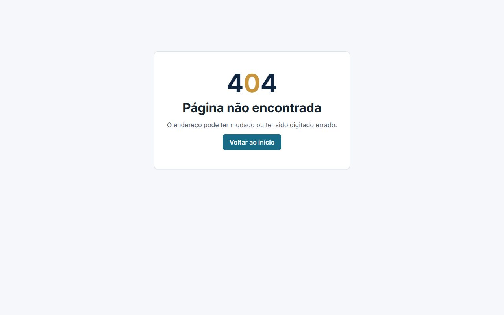

# Projeto de Interface

Pré-requisito: [Especificação do Projeto](02-Especificação%20do%20Projeto.md). Identidade visual e componentes em [Template Padrão da Aplicação](06-Template%20Padrão%20da%20Aplicação.md).

Os wireframes da fase acadêmica eram apenas descritivos; este documento registra as telas **implementadas**, o fluxo de cada papel e prints reais.

## Mapa de telas do painel web

| Rota | Tela | Quem |
|---|---|---|
| `/` | Início: o que é, módulos, perfis e "Explore a demonstração" | público |
| `/sobre` | Como foi feito: arquitetura, decisões, testes, limitações | público |
| `/entrar` | Entrar (e-mail e senha; o papel vem do token) | público |
| `/cadastro` | Ativar acesso de morador em dois passos (vínculo, depois dados e senha) | público |
| `/primeiro-acesso` | Criar a senha pessoal (conta nova ou senha redefinida) | quem entrou com o código |
| `/recuperar-senha` | Como recuperar a senha (pela administração; o sistema não envia e-mail) | público |
| `/painel` | Resumo por papel: gestão, morador ou portaria | logado |
| `/painel/:modulo` | Avisos, Ocorrências, Assembleias, Votos, Visitantes, Encomendas, Áreas comuns, Reservas, Estacionamento, Cobranças, Pagamentos, Condomínios, Unidades, Usuários, Pets | conforme o papel |
| `/painel/perfil` | Dados da conta e troca de senha | logado |
| qualquer outra | 404 (com volta ao início ou ao painel), 403 dentro do painel, tela de erro inesperado | |

Sessão expirada (401): volta para `/entrar` com o aviso "Sua sessão expirou" e retorna à página onde a pessoa estava depois do login.

## Fluxo por papel

## App (Expo)

Onboarding de 3 telas no primeiro uso, login (com "Explore a demonstração" quando a API está em modo demo), cadastro em dois passos, primeiro acesso, e as abas Início (mural de avisos; síndico publica), Ocorrências, Reservas (com seletor nativo de data e hora), Perfil e Mais (Encomendas, Visitantes, Financeiro, Assembleias, Votos, Áreas comuns, Pets e, para a gestão, Condomínio, Unidades e Usuários), cada uma com botão voltar.

## Prints (versão atual)

Tirados no Chrome headless com `ferramentas/capturar-telas.mjs`, entrando pela demonstração.

| | |
|---|---|
|  |  |
| Início: proposta e "Explore a demonstração" | Entrar, com "Entrar como" síndico, morador ou porteiro |
|  |  |
| Painel da gestão: o que precisa de atenção | Reservas com calendário mensal |
|  |  |
| Como foi feito (arquitetura e decisões) | Página não encontrada |
|  |  |
| Resumo do morador (375 px) | Portaria (375 px) |
|  |  |
| App: entrar com a demonstração | App: cobranças e pagamentos |

## Estados e mensagens

Toda lista tem carregando (esqueleto ou indicador), vazio com orientação ("Nenhuma reserva neste mês") e erro com "Tentar de novo". Ações dão retorno por aviso (toast no painel) e as destrutivas pedem confirmação num diálogo próprio. Erros da API chegam traduzidos; erro inesperado mostra "Ocorreu um erro inesperado. Tente novamente." sem detalhe técnico.
