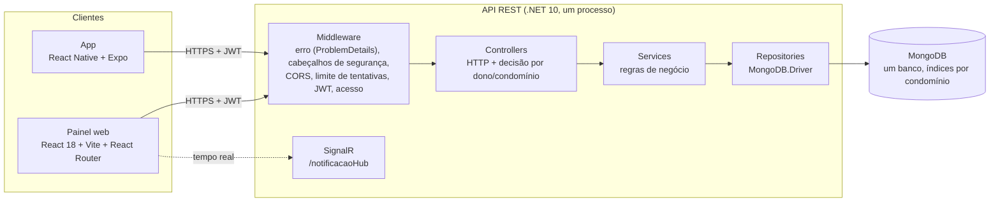

# Arquitetura da Solução

Arquitetura **real** do Gestão Pro: um monólito modular (uma API REST em .NET 10 com um MongoDB) servido a dois clientes (painel web em React e app em React Native/Expo). A proposta acadêmica de microsserviços ficou registrada em [historico/05-Arquitetura proposta (versão acadêmica)](historico/05-Arquitetura%20proposta%20(versão%20acadêmica).md); o motivo da troca está no [ADR 0001](adr/0001-monolito-modular.md).

## Visão geral

| Camada | Pasta | Responsabilidade |
|---|---|---|
| Middleware | `src/GestaoPro.API/Middleware`, `Program.cs` | Erro inesperado vira ProblemDetails sem detalhe interno; cabeçalhos de segurança e CSP; CORS só para origens configuradas; limite de tentativas nas rotas anônimas de autenticação; JWT; regra geral de leitura/escrita por papel (`ApiAccessMiddleware`). |
| Controllers | `Controllers/` | Recebem a requisição, leem o chamador do token (`this.Caller()`), decidem o acesso com `ResourceAccess` e devolvem 200/400/403/404. Não acessam o banco direto. |
| Services | `Services/` | Regras de negócio: conflito de horário e trava da reserva, política de senha, código do condomínio, autoatendimento, votação, financeiro, modo demonstração. |
| Repositories | `Repositories/` | Consultas MongoDB, sempre filtradas pelo condomínio quando a lista é de um condomínio, com índices criados na partida. |
| Painel web | `src/GestaoPro.Web/src` | `app` (rotas), `layouts`, `pages`, `features` (módulos), `api` (HTTP), `auth` (sessão), `domain` (tipos), `lib` (máscaras, rótulos, formulários), `components/ui`, `styles` (tokens). |
| App | `src/GestaoPro.Mobile/src` | `navigation` (abas + pilha do "Mais"), `screens`, `components`, `api/client.ts`, `theme/theme.ts`, `utils`. |

## Segurança e acesso

- **Identidade só do token** (`userId`, `role`, `condominiumId`). Papéis: `admin`, `sindico`, `porteiro`, `morador` ([ADR 0002](adr/0002-acesso-decidido-no-servidor.md)).
- **Isolamento por condomínio:** item de outro condomínio responde 404 (igual a inexistente); sem permissão, 403. Listas consultam o banco já filtradas.
- **Rotas anônimas** (login, verificação de CPF, cadastro, primeiro acesso): mensagens únicas, uma verificação BCrypt por tentativa (o tempo não revela se a conta existe) e limite de tentativas por IP e por condomínio, com `Retry-After`.
- **Senhas:** política única no servidor (8 a 128 caracteres, sem senhas óbvias); hash BCrypt gerado só na API.
- **Configuração:** variáveis de ambiente vencem o arquivo local; nenhum segredo no Git ([ADR 0006](adr/0006-configuracao-e-segredos.md)).
- **Produção:** Swagger fechado, CORS restrito, HSTS em HTTPS, `X-Content-Type-Options`, `X-Frame-Options`, `Referrer-Policy`, CSP.
- **Modo demonstração** por flag, com contas protegidas e reset periódico ([ADR 0004](adr/0004-modo-demonstracao.md)).

## Fluxos principais

| Fluxo | Caminho |
|---|---|
| Entrar | `POST /api/Auth/login` → token; se a conta precisa trocar a senha, a resposta pede o primeiro acesso (`PATCH /api/Auth/change-password`). |
| Ativar acesso de morador | `GET /api/Condominiums/public` (id e nome) → `POST /api/auth/check-cpf` (condomínio + CPF + código do condomínio) → `POST /api/auth/register`. |
| Reservar área comum | `POST /api/reservations`: confere horário de funcionamento, data, e conflito **sob trava por área e data** ([ADR 0005](adr/0005-trava-de-reserva.md)). |
| Portaria | `POST /api/Visitor/register`, `check-in`, `check-out`; `POST /api/Delivery` e `PUT /api/Delivery/{id}/pickup`. |
| Demonstração | `GET /api/demo` (papéis e código do condomínio, só com `Demo:Enabled=true`) → "Entrar como ..." no painel e no app → `POST /api/demo/entrar` devolve a sessão do papel, sem senha. Token de antes do último reset vira 401 ([ADR 0004](adr/0004-modo-demonstracao.md)). |

## Dados (MongoDB)

Um banco por ambiente (local, demonstração, produção). Coleções usadas pelo código:

| Coleção | Conteúdo | Índices principais |
|---|---|---|
| `condominiums` | condomínio, endereço, regras, hash do código do condomínio | `cnpj` único |
| `users` | pessoas (morador, síndico, porteiro, admin), unidade, contato | `email` único, `registrationNumber` único, por condomínio |
| `credentials` | login (e-mail ou matrícula), hash da senha, papel, troca obrigatória | `userId` único, `registrationNumber` único |
| `units` | unidades e moradores vinculados | `condominiumId + number` |
| `announcements` | avisos | `condominiumId + createdAt` |
| `commonareas` | áreas comuns e horário de funcionamento | `condominiumId + name` |
| `reservations` | reservas | `condominiumId + date`, `userId`, `commonAreaId + date` |
| `reservation_locks` | travas temporárias de reserva | TTL em `expiresAt` |
| `visitors`, `deliveries`, `packages` | portaria | sem índice dedicado (volume baixo; candidato a índice por condomínio) |
| `occurrences` | ocorrências e histórico de status | `condominiumId + status`, `userId + createdAt` |
| `parking` | vagas e reservas de vaga | sem índice (número único por condomínio garantido no serviço) |
| `assembly`, `votes`, `proxyVotes` | assembleias, pautas e votos | `condominiumId` nas assembleias; voto único por usuário e pauta |
| `bills`, `payments` | cobranças e pagamentos | sem índice dedicado |
| `pets` | pets por unidade e tutor | criados no repositório de pets |

O diagrama de classes da fase acadêmica continua em [img/ClassDiagram_mongodb.png](img/ClassDiagram_mongodb.png) (os nomes de algumas coleções mudaram; a tabela acima vale).

## Hospedagem

API no Render (Docker), painel e app web na Vercel, MongoDB Atlas só de demonstração ([ADR 0007](adr/0007-hospedagem-gratuita.md), passo a passo em [deploy.md](deploy.md)). Localmente, `iniciar.bat` sobe o MongoDB do `compose.yaml`, a API e o painel.

## Qualidade

- Testes: API com xUnit (unidade e integração com `WebApplicationFactory`), painel com Vitest e Testing Library, utilitários do app com Vitest. Registro em [08-Registro de Testes Unitários](08-Registro%20de%20Testes%20Unitários.md).
- Lint: ESLint no painel e no app; `.editorconfig` para o C#.
- CI: GitHub Actions (`.github/workflows/ci.yml`).
- Estresse: k6 com hipóteses escritas antes de medir, em [carga/](carga/). Os [resultados](carga/2026-10-04-resultados.md) comparam a `main` com esta versão: leitura de avisos com outro condomínio no banco de 43 para 2.988 req/s, lista do cadastro de 80 para 4.728 req/s e corrida de reservas resolvida.
