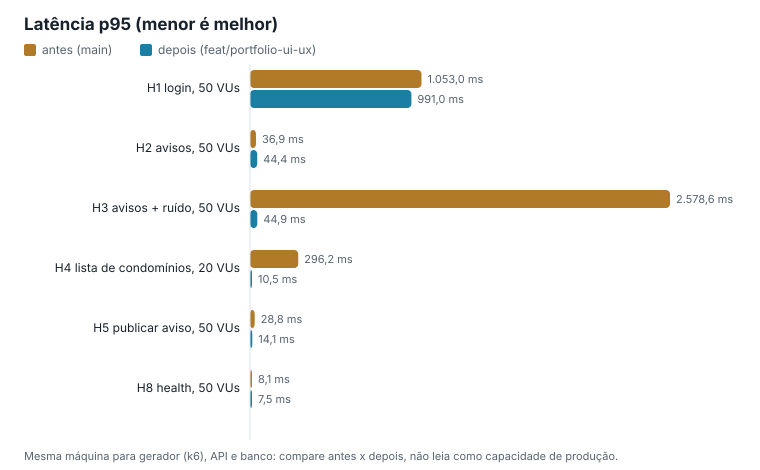

# Teste de estresse do GestaoPro: resultados

As hipóteses foram escritas e versionadas antes da primeira medição, em
[2026-10-04-hipoteses.md](2026-10-04-hipoteses.md). Este arquivo mostra o que foi medido em 13 e 14/10/2026 e diz,
para cada hipótese, se ela se confirmou ou não.

## Como foi medido

- **Antes:** build da `main` (`047b9bd`). **Depois:** build da `feat/portfolio-ui-ux` (código da API de `38cdb1c`; a 2ª rodada foi publicada de `ac0fde3`, com o mesmo código da API).
  Os dois foram publicados com `dotnet publish -c Release` numa pasta temporária, **sem** `appsettings.Local.json`.
- **Banco descartável:** `mongod` 8.2.6 local, porta 27100, base `GestaoProStress`, pasta de dados temporária apagada
  no fim, preso a 2 threads da CPU. O Docker não respondia no começo da sessão, por isso o banco não rodou em
  container. Nenhuma medição tocou o banco real.
- **Portão:** antes da primeira requisição, `tests/carga/portao.mjs` confirmou que a API respondia com a base
  `GestaoProStress`. Nas três rodadas o portão passou.
- **Uma carga por vez:** cada rodada criou a trava `.carga-lock` só no início da medição e a apagou no fim.
- **Gerador:** k6 2.2.0, na mesma máquina (Ryzen 5 5600, 6 núcleos e 12 threads, 16 GB).
- **Roteiro:** `bash tests/carga/executar.sh <antes|depois> <porta> <pasta-do-publish> <pasta-de-saida>`.
  Com `SOAK=1`, roda também H9. Tabela e gráficos: `node tests/carga/relatorio.mjs <antes> <depois> docs/carga`.

### Janelas de medição

| Rodada | Início | Fim | Uso |
|---|---|---|---|
| antes | 13/10 23:04:55 | 13/10 23:13:02 | H1 a H8 |
| depois, 1ª rodada | 13/10 23:55:05 | 14/10 00:14:05 | H1 a H8 (tabela e gráficos) |
| depois, 2ª rodada | 15/10 00:04:49 | 15/10 00:24:28 | H9 (soak de 00:13:10 a 00:23:11) e repetição de H1 a H8 |

Descobrimos depois que o roteiro de carga de outro projeto (Cineclube) não respeitava a trava. As janelas dele
(04/10 18:26 a 18:47 e 13/10 21:39 a 22:06) não cruzam nenhuma das janelas acima. A rodada "antes" foi repetida às
23:04: a de 22:53 caiu num erro do roteiro (o Git Bash trocava `-e CAMINHO=/api/...` por um caminho do Windows, e todas
as leituras falharam sem chegar à API). Os números dela foram descartados, e o roteiro foi corrigido em `1bdd866`.

## Resultados

| Cenário | Antes: req/s | Antes: p95 (ms) | Antes: erro | Depois: req/s | Depois: p95 (ms) | Depois: erro |
|---|---:|---:|---:|---:|---:|---:|
| H1 login, 10 VUs | 65,8 | 169,4 | 0,00% | 70,7 | 153,1 | 0,00% |
| H1 login, 50 VUs | 75,4 | 1.053,0 | 0,00% | 78,0 | 991,0 | 0,00% |
| H2 avisos, 10 VUs | 4.420,9 | 4,9 | 0,00% | 3.019,7 | 6,7 | 0,00% |
| H2 avisos, 50 VUs | 3.880,3 | 36,9 | 0,00% | 3.036,4 | 44,4 | 0,00% |
| H2 avisos, 100 VUs | 3.722,2 | 78,7 | 0,00% | 2.998,3 | 91,4 | 0,00% |
| H2 avisos, 200 VUs | 4.138,5 | 87,2 | 0,00% | 2.895,8 | 113,0 | 0,00% |
| H3 avisos + 20 mil de outro condomínio, 10 VUs | 43,2 | 382,5 | 0,00% | 3.075,3 | 6,5 | 0,00% |
| H3 avisos + ruído, 50 VUs | 42,5 | 2.578,6 | 0,00% | 2.987,7 | 44,9 | 0,00% |
| H3 avisos + ruído, 100 VUs | 41,8 | 4.755,5 | 0,00% | 2.952,2 | 93,1 | 0,00% |
| H4 lista de condomínios (cadastro), 10 VUs | 77,9 | 150,0 | 0,00% | 4.700,5 | 4,1 | 0,00% |
| H4 lista de condomínios, 20 VUs | 79,8 | 296,2 | 0,00% | 4.728,1 | 10,5 | 0,00% |
| H4 lista de condomínios, 50 VUs | 77,9 | 753,7 | 0,00% | 4.660,7 | 29,0 | 0,00% |
| H5 publicar aviso, 50 VUs | 4.575,8 | 28,8 | 0,00% | 7.558,9 | 14,1 | 0,00% |
| H8 health, 50 VUs | 12.588,3 | 8,1 | 0,00% | 15.495,1 | 7,5 | 0,00% |
| H6 50 reservas simultâneas, mesmo horário | 50 aceitos, 0 recusados (4xx), 0 com erro (5xx) | | | 1 aceitos, 49 recusados (4xx), 0 com erro (5xx) | | |
| H7 50 votos simultâneos, mesma pauta | 1 aceitos, 49 recusados (4xx), 0 com erro (5xx) | | | 1 aceitos, 49 recusados (4xx), 0 com erro (5xx) | | |
| H1b mediana do login (1 VU) | inexistente 9,5 ms x senha errada 113,9 ms | | | inexistente 119,4 ms x senha errada 111,7 ms | | |

Recursos do processo da API (CPU acumulada e memória do conjunto de trabalho):

| Cenário | Antes: CPU por requisição | Depois: CPU por requisição |
|---|---:|---:|
| H2 avisos, 50 VUs | 0,79 ms | 0,83 ms |
| H3 avisos + ruído, 50 VUs | 115,3 ms | 0,84 ms |
| H4 lista de condomínios, 20 VUs | 32,9 ms | 0,79 ms |

Memória da API no fim de H3 (100 VUs): antes 810 MB, depois 210 MB. A CPU foi medida pelo tempo de processador do processo da API, dividido pelo número de requisições do cenário.

## Hipóteses

| # | Resultado | O que os números mostram |
|---|---|---|
| H1 | **Confirmada** (antes e depois) | 66 e 75 req/s antes, 71 e 78 req/s depois (10 e 50 VUs). p95 com 10 VUs: 169 ms antes e 153 ms depois. Acima disso a latência cresce em fila (p95 próximo de 1 s com 50 VUs). Nenhum 5xx. |
| H1b | **Confirmada** | Antes: mediana de 9,5 ms para e-mail inexistente contra 113,9 ms para senha errada, uma diferença de 104 ms que permite descobrir quais e-mails têm conta. Depois: 119,4 ms contra 111,7 ms, diferença de 7,7 ms (abaixo de 10 ms). |
| H2 | **Confirmada**, com uma perda não prevista | Com 50 VUs: 3.880 req/s e p95 de 37 ms antes, 3.036 req/s e p95 de 44 ms depois. Os dois passam do mínimo (1.000 req/s, p95 abaixo de 50 ms). Mas o depois fez de 19% a 32% menos req/s em todos os degraus. A CPU por requisição da API ficou igual (0,79 e 0,83 ms), então a diferença está fora do processo da API. A explicação provável, não medida, é que o filtro e a ordem agora rodam no MongoDB, limitado a 2 threads neste teste. |
| H3 | **Confirmada** | Antes, 20 mil avisos de outro condomínio derrubaram a leitura de 4.421 para 43 req/s (100 vezes menos) e levaram o p95 a 383 ms com 10 VUs e a 4,8 s com 100 VUs. A memória da API foi de 172 MB para 810 MB, e cada requisição custou 115 ms de CPU, contra 0,8 ms em H2. Depois, H3 ficou igual a H2 (3.075 contra 3.020 req/s com 10 VUs), bem dentro da margem de 20%. |
| H4 | **Em parte**: o depois se confirmou e o antes ficou abaixo do previsto | Antes (N+1): 80 req/s e p95 de 296 ms com 20 VUs. A hipótese previa p95 acima de 1 s, e o real foi menor. Depois (`/public`, uma consulta com projeção): 4.728 req/s e p95 de 10,5 ms, abaixo dos 50 ms previstos. O ganho foi de 59 vezes em req/s. |
| H5 | **Confirmada** | 4.576 req/s e p95 de 29 ms antes, contra 7.559 req/s e p95 de 14 ms depois: 65% mais rápido, acima dos 15% previstos. Nenhum erro. |
| H6 | **Confirmada** | Antes, as 50 reservas simultâneas para o mesmo horário e a mesma área foram **todas aceitas**. Depois, 1 aceita, 49 recusadas com 4xx e nenhum 5xx. Uma reserva gravada no banco. |
| H7 | **Confirmada** | Antes e depois: 1 voto gravado, 49 recusados com 4xx e nenhum 5xx. |
| H8 | **Em parte**: refutada no antes, confirmada no depois | O antes não sofreu com o "cliente novo por chamada": 12.588 req/s e p95 de 8,1 ms, sem erros. O driver do MongoDB reaproveita o cluster quando a configuração é a mesma. Depois: 15.495 req/s e p95 de 7,5 ms, ou seja, 23% a mais. A troca continua certa (um cliente só, timeout de 5 s, sem detalhe de erro na resposta), mas o ganho foi pequeno e não o previsto. |
| H9 | **Confirmada** (2ª rodada) | 10 minutos a 1.498 req/s (teto de 1.500, cerca de 50% da capacidade de H2): 898.964 requisições, p95 de 2,1 ms e nenhum erro. A memória da API foi de 154 MB no minuto 2 para 141 MB no minuto 10, uma queda de 8%. A 1ª rodada foi inconclusiva: também sem erros e sem crescimento de memória, mas o soak rodou depois de H5, com o condomínio cheio de avisos, e só fez 24 req/s (veja o achado abaixo). |

## Achado fora das hipóteses: contagem de avisos num condomínio enorme

Na 1ª rodada "depois", o soak rodou depois de H5. Cada escrita de H5 cria um aviso no condomínio lido em H2 e H3, e
assim o condomínio chegou a cerca de 227 mil avisos. Com 25 VUs em `GET /api/announcements?page=1&pageSize=20`, a API
fez só 24 req/s, com p50 de 0,9 s e p95 de 2 s. Mesmo assim não houve nenhum erro, e a memória ficou estável (de 191 MB
para 166 MB). A CPU da API quase não trabalhou nessa fase (17 s em 10 min), então o gargalo estava no banco.

A suspeita é o `CountDocuments` do total (`X-Total-Count`), que conta todos os avisos do condomínio a cada página.
Isso não foi medido em separado. Um condomínio real não chega perto de 227 mil avisos, mas a correção é simples:
contar com limite (por exemplo, "10.000 ou mais") ou só na primeira página. Ficou registrada no roadmap.

O roteiro foi ajustado em seguida: H9 agora roda antes de H5 e tem um teto de req/s (`6d51965`). Foi assim que a 2ª
rodada mediu H9.

## Repetição: a 2ª rodada "depois"

A 2ª rodada repetiu H1 a H8 com o mesmo build, na mesma máquina, para dar uma ideia da variação entre rodadas iguais.

| Cenário | 1ª rodada | 2ª rodada | Diferença |
|---|---:|---:|---:|
| H1 login, 50 VUs | 78 req/s | 78 req/s | 0% |
| H2 avisos, 50 VUs | 3.036 req/s | 2.971 req/s | -2% |
| H3 avisos + ruído, 50 VUs | 2.988 req/s | 2.974 req/s | 0% |
| H4 lista de condomínios, 20 VUs | 4.728 req/s | 3.682 req/s | -22% |
| H5 publicar aviso, 50 VUs | 7.559 req/s | 10.076 req/s | +33% |
| H8 health, 50 VUs | 15.495 req/s | 14.496 req/s | -6% |
| H6, H7 | 1 aceito, 49 com 4xx | 1 aceito, 49 com 4xx | igual |
| H1b (inexistente x senha errada) | 119,4 x 111,7 ms | 121,9 x 113,9 ms | diferença de 8 ms |

Os cenários de leitura e o login se repetiram quase iguais. H4 e H5 variaram 22% e 33% de uma rodada para a outra,
então diferenças desse tamanho não provam nada sozinhas. As conclusões continuam valendo, porque os efeitos são bem
maiores que essa variação: H3 (70 vezes), H4 (46 a 59 vezes), H5 (65% a 120% acima do antes) e H6. Já o ganho de H8
(23% na 1ª rodada, 15% na 2ª) fica dentro da variação, e a perda de H2 se repetiu (23% abaixo do antes na 2ª rodada).

## Limitações

- Gerador, API e banco dividem a mesma máquina. Os números servem para comparar antes e depois, não como capacidade de
  produção. A hospedagem gratuita (Render) tem bem menos CPU.
- A máquina não estava isolada: outros agentes trabalhavam nela, sem carga, durante as medições. A trava evitou
  outra carga ao mesmo tempo.
- O banco rodou como `mongod` direto, sem Docker, preso a 2 threads. Com mais threads para o banco, a perda de H2
  pode diminuir ou sumir.
- Cada cenário durou 30 s. O antes foi medido uma vez, e o depois duas. A variação entre rodadas iguais chegou a 33% (veja a repetição acima).
- Os dados brutos (resumos do k6, logs e uso de CPU e memória) ficaram fora do Git, na pasta temporária da sessão.
  A tabela e os gráficos acima foram gerados a partir deles.
