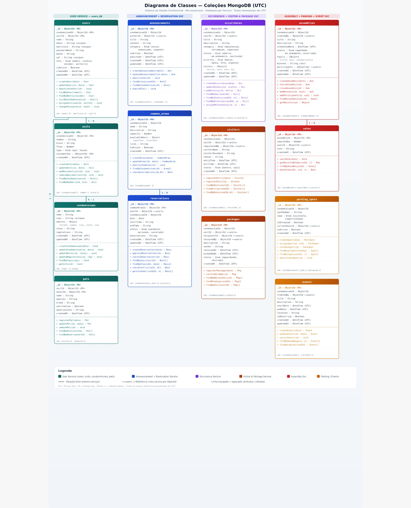

> **Histórico.** Esta é a arquitetura proposta na fase acadêmica (microsserviços, gateway e RabbitMQ). Ela **não** foi a implementada: a arquitetura real é o monólito modular descrito em [05-Arquitetura da Solução](../05-Arquitetura%20da%20Solução.md) e no [ADR 0001](../adr/0001-monolito-modular.md).

# Arquitetura da Solução

A solução será estruturada em uma **arquitetura de microsserviços** composta por múltiplos serviços independentes, cada um responsável por um domínio funcional específico do sistema de gestão condominial. As aplicações clientes — uma aplicação web (para administradores e síndicos) e um aplicativo mobile (para moradores) — se comunicam exclusivamente por meio de um **API Gateway**, que roteia as requisições para o microsserviço adequado.

Cada microsserviço possui seu próprio banco de dados MongoDB (padrão **Database-per-Service**), garantindo baixo acoplamento e independência de deploy. A comunicação assíncrona entre serviços é realizada por meio de um **Message Broker (RabbitMQ)**, utilizado para eventos como notificações push e propagação de dados entre domínios.

## Visão Geral da Arquitetura


## Componentes da Arquitetura

### Camada de Apresentação (Clientes)

**Aplicação Web (React)** — Utilizada por administradores e síndicos para gestão completa do condomínio: cadastro de moradores, publicação de avisos, gerenciamento de reservas, eventos, assembleias, visitantes e encomendas.

**Aplicação Mobile (React Native)** — Voltada para moradores, permitindo acesso rápido a avisos, reservas de áreas comuns, calendário de eventos, registro de solicitações e consulta de encomendas.

Ambas as aplicações se comunicam com o backend exclusivamente via HTTPS, consumindo a API REST exposta pelo API Gateway.

### API Gateway (Ocelot / YARP)

Ponto de entrada único para todas as requisições dos clientes. Responsável por:

- Roteamento inteligente para o microsserviço correto
- Validação de tokens JWT (autenticação centralizada)
- Rate Limiting e proteção contra abuso
- Load Balancing entre instâncias de serviços
- Agregação de respostas quando necessário

### Microsserviços (ASP.NET Core Web API)

Cada microsserviço é uma aplicação ASP.NET Core independente, executando em seu próprio processo/container:

| Microsserviço | Domínio | Requisitos Atendidos |
|---|---|---|
| **Auth Service** | Autenticação JWT, autorização por roles, login por matrícula/senha | RF-003, RNF-002 |
| **User Service** | Cadastro de moradores, administradores, unidades e pets | RF-001, RF-002, RF-030, RF-031 |
| **Announcement Service** | Avisos, comunicados e notificações push | RF-004, RF-005, RF-011 |
| **Reservation Service** | Reservas de áreas comuns, calendário de disponibilidade | RF-006, RF-007, RF-009, RF-014 |
| **Occurrence Service** | Solicitações, ocorrências e manutenções | RF-012, RF-013, RF-028, RF-029 |
| **Visitor & Package Service** | Registro de visitantes, encomendas e controle de acesso | RF-019, RF-020, RF-021, RF-022 |
| **Assembly Service** | Assembleias virtuais, votações digitais e atas | RF-023, RF-024, RF-025 |
| **Parking Service** | Vagas de estacionamento de visitantes e uso compartilhado | RF-015, RF-016, RF-017, RF-018 |
| **Event & Calendar Service** | Eventos do condomínio, calendário geral, regras e regulamentos | RF-008, RF-010, RF-026, RF-027 |

### Comunicação Assíncrona (RabbitMQ)

O Message Broker é utilizado para comunicação entre microsserviços de forma desacoplada. Exemplos de eventos publicados:

- `announcement.created` → Dispara notificação push para moradores (Announcement → Notification)
- `occurrence.statusChanged` → Atualiza histórico e notifica morador (Occurrence → User)
- `package.received` → Notifica morador sobre encomenda (Visitor & Package → Notification)
- `assembly.voteOpened` → Notifica moradores aptos a votar (Assembly → User)

### Camada de Dados (MongoDB Atlas — Database-per-Service)

Cada microsserviço possui seu banco de dados exclusivo no MongoDB Atlas, garantindo autonomia e escalabilidade independente:

| Banco | Coleções | Serviço |
|---|---|---|
| `auth_db` | credentials | Auth Service |
| `users_db` | users, units, condominiums, pets | User Service |
| `announcements_db` | announcements | Announcement Service |
| `reservations_db` | common_areas, reservations | Reservation Service |
| `occurrences_db` | occurrences | Occurrence Service |
| `visitors_db` | visitors, packages | Visitor & Package Service |
| `assemblies_db` | assemblies, votes | Assembly Service |
| `parking_db` | parking_spots | Parking Service |
| `events_db` | events | Event & Calendar Service |

### Comunicação entre Componentes

1. O usuário acessa a aplicação web ou mobile.
2. A aplicação envia uma requisição HTTPS ao API Gateway.
3. O Gateway valida o token JWT e roteia a requisição ao microsserviço correto.
4. O microsserviço processa a lógica de negócio e acessa seu banco de dados exclusivo.
5. Caso necessário, o microsserviço publica um evento no RabbitMQ.
6. Outros microsserviços interessados consomem o evento e executam suas ações.
7. A resposta retorna ao cliente pelo mesmo caminho.

### Benefícios da Arquitetura de Microsserviços

- **Escalabilidade independente**: cada serviço pode ser escalado conforme sua demanda (ex.: Reservation Service em períodos de alta procura).
- **Deploy independente**: atualizações em um serviço não afetam os demais.
- **Resiliência**: falha em um serviço não derruba todo o sistema.
- **Flexibilidade tecnológica**: cada serviço pode evoluir independentemente.
- **Manutenção facilitada**: equipes podem trabalhar em serviços separados com mínima coordenação.

### Tecnologias Utilizadas

| Camada | Tecnologia |
|---|---|
| Frontend Web | React (JavaScript) |
| Frontend Mobile | React Native (Expo) |
| API Gateway | ASP.NET Core com Ocelot/YARP |
| Microsserviços | C# ASP.NET Core 8 Web API |
| Banco de Dados | MongoDB Atlas (NoSQL) |
| Message Broker | RabbitMQ |
| Autenticação | JWT (JSON Web Tokens) |
| Documentação API | Swagger / OpenAPI 3.0 |
| Hospedagem | Azure App Service + MongoDB Atlas |
| CI/CD | GitHub Actions + Docker |
| Monitoramento | Serilog + Health Checks |

---

## Diagrama de Classes

O diagrama abaixo representa as coleções MongoDB do sistema e seus relacionamentos, organizados por microsserviço seguindo o padrão Database-per-Service.

 

---

## Esquema do Banco de Dados MongoDB

Este documento descreve a estrutura e o esquema do banco de dados não relacional utilizado pelo sistema, baseado em MongoDB Atlas. O MongoDB armazena dados em documentos BSON, permitindo uma estrutura flexível e escalável. Cada microsserviço possui seu próprio banco de dados, seguindo o padrão Database-per-Service.

---

### Coleção: `users`
**Banco:** `users_db` · **Serviço:** User Service

Armazena as informações dos usuários do sistema (moradores, administradores, síndicos e porteiros).

```json
{
    "_id": "ObjectId('665a1b2c3d4e5f6a7b8c9d01')",
    "condominiumId": "ObjectId('665a1b2c3d4e5f6a7b8c9d00')",
    "unitId": "ObjectId('665a1b2c3d4e5f6a7b8c9d10')",
    "name": "João Carlos Ferreira",
    "email": "joao.ferreira@email.com",
    "matricula": "COND-2026-0001",
    "passwordHash": "$2b$12$LJ3m5...",
    "phone": "(31) 99999-0001",
    "cpf": "123.456.789-00",
    "role": "morador",
    "isActive": true,
    "createdAt": "2026-03-10T10:00:00Z",
    "updatedAt": "2026-03-10T10:00:00Z"
}
```

**Descrição dos Campos:**
- **_id**: Identificador único do usuário gerado automaticamente pelo MongoDB.
- **condominiumId**: Referência ao condomínio ao qual o usuário pertence.
- **unitId**: Referência à unidade (apartamento/casa) do morador. Nulo para administradores sem unidade.
- **name**: Nome completo do usuário.
- **email**: Endereço de e-mail (único no sistema).
- **matricula**: Código de matrícula fornecido pela administração, utilizado no login.
- **passwordHash**: Hash BCrypt da senha do usuário.
- **phone**: Telefone de contato.
- **cpf**: CPF do usuário (único no sistema).
- **role**: Papel do usuário no sistema. Valores aceitos: `admin`, `sindico`, `morador`, `porteiro`.
- **isActive**: Indica se o usuário está ativo no sistema.
- **createdAt / updatedAt**: Timestamps de criação e última atualização.

**Índices:** `{ email: 1 }` (unique), `{ matricula: 1 }` (unique), `{ condominiumId: 1, role: 1 }`

---

### Coleção: `units`
**Banco:** `users_db` · **Serviço:** User Service

Armazena as unidades (apartamentos ou casas) do condomínio.

```json
{
    "_id": "ObjectId('665a1b2c3d4e5f6a7b8c9d10')",
    "condominiumId": "ObjectId('665a1b2c3d4e5f6a7b8c9d00')",
    "number": "101",
    "block": "A",
    "floor": 1,
    "type": "apt",
    "residentIds": [
        "ObjectId('665a1b2c3d4e5f6a7b8c9d01')",
        "ObjectId('665a1b2c3d4e5f6a7b8c9d02')"
    ],
    "createdAt": "2026-03-10T09:00:00Z"
}
```

**Descrição dos Campos:**
- **_id**: Identificador único da unidade.
- **condominiumId**: Referência ao condomínio.
- **number**: Número da unidade (ex.: "101", "202").
- **block**: Bloco ou torre (ex.: "A", "B").
- **floor**: Andar da unidade.
- **type**: Tipo da unidade. Valores aceitos: `apt` (apartamento), `house` (casa).
- **residentIds**: Array de ObjectIds referenciando os moradores cadastrados na unidade.
- **createdAt**: Timestamp de criação.

**Índices:** `{ condominiumId: 1, number: 1, block: 1 }` (unique compound)

---

### Coleção: `condominiums`
**Banco:** `users_db` · **Serviço:** User Service

Armazena as informações gerais do condomínio.

```json
{
    "_id": "ObjectId('665a1b2c3d4e5f6a7b8c9d00')",
    "name": "Residencial Parque das Flores",
    "cnpj": "12.345.678/0001-90",
    "address": {
        "street": "Rua das Acácias",
        "number": "500",
        "neighborhood": "Jardim América",
        "city": "Belo Horizonte",
        "state": "MG",
        "zipCode": "30000-000"
    },
    "rules": "Texto com as regras gerais do condomínio...",
    "regulations": "Texto com o regulamento interno...",
    "createdAt": "2026-03-04T08:00:00Z",
    "updatedAt": "2026-03-04T08:00:00Z"
}
```

**Descrição dos Campos:**
- **_id**: Identificador único do condomínio.
- **name**: Nome oficial do condomínio.
- **cnpj**: CNPJ do condomínio (único).
- **address**: Subdocumento contendo endereço completo (street, number, neighborhood, city, state, zipCode).
- **rules**: Texto contendo as regras gerais do condomínio (RF-008).
- **regulations**: Texto contendo o regulamento interno.
- **createdAt / updatedAt**: Timestamps de controle.

**Índices:** `{ cnpj: 1 }` (unique)

---

### Coleção: `announcements`
**Banco:** `announcements_db` · **Serviço:** Announcement Service

Armazena avisos e comunicados publicados pela administração.

```json
{
    "_id": "ObjectId('665a2a1b3c4d5e6f7a8b9c01')",
    "condominiumId": "ObjectId('665a1b2c3d4e5f6a7b8c9d00')",
    "authorId": "ObjectId('665a1b2c3d4e5f6a7b8c9d05')",
    "title": "Manutenção na Piscina",
    "content": "Informamos que a piscina ficará indisponível para manutenção preventiva nos dias 15 e 16 de março.",
    "category": "aviso",
    "isActive": true,
    "expiresAt": "2026-03-17T23:59:59Z",
    "createdAt": "2026-03-12T14:00:00Z",
    "updatedAt": "2026-03-12T14:00:00Z"
}
```

**Descrição dos Campos:**
- **_id**: Identificador único do aviso.
- **condominiumId**: Referência ao condomínio.
- **authorId**: Referência ao usuário (admin/síndico) que publicou o aviso.
- **title**: Título do aviso.
- **content**: Conteúdo completo do aviso.
- **category**: Categoria do aviso. Valores aceitos: `aviso`, `comunicado`, `urgente`.
- **isActive**: Indica se o aviso está visível para os moradores.
- **expiresAt**: Data de expiração automática do aviso.
- **createdAt / updatedAt**: Timestamps de controle.

**Índices:** `{ condominiumId: 1, createdAt: -1 }`, `{ condominiumId: 1, isActive: 1 }`

---

### Coleção: `common_areas`
**Banco:** `reservations_db` · **Serviço:** Reservation Service

Armazena as áreas comuns disponíveis para reserva no condomínio.

```json
{
    "_id": "ObjectId('665a3a1b3c4d5e6f7a8b9c01')",
    "condominiumId": "ObjectId('665a1b2c3d4e5f6a7b8c9d00')",
    "name": "Salão de Festas",
    "description": "Salão com capacidade para 80 pessoas, equipado com cozinha e banheiros.",
    "capacity": 80,
    "availableHours": {
        "openTime": "08:00",
        "closeTime": "22:00"
    },
    "rules": "Reservar com no mínimo 3 dias de antecedência. Limite de som até 22h.",
    "isActive": true,
    "createdAt": "2026-03-05T10:00:00Z"
}
```

**Descrição dos Campos:**
- **_id**: Identificador único da área comum.
- **condominiumId**: Referência ao condomínio.
- **name**: Nome do espaço (ex.: Salão de Festas, Churrasqueira, Academia).
- **description**: Descrição detalhada do espaço e equipamentos.
- **capacity**: Capacidade máxima de pessoas.
- **availableHours**: Subdocumento com horários de funcionamento (openTime e closeTime).
- **rules**: Regras específicas de uso do espaço.
- **isActive**: Indica se o espaço está disponível para reservas.
- **createdAt**: Timestamp de criação.

**Índices:** `{ condominiumId: 1 }`

---

### Coleção: `reservations`
**Banco:** `reservations_db` · **Serviço:** Reservation Service

Armazena as reservas de áreas comuns realizadas pelos moradores.

```json
{
    "_id": "ObjectId('665a3b1b3c4d5e6f7a8b9c01')",
    "commonAreaId": "ObjectId('665a3a1b3c4d5e6f7a8b9c01')",
    "userId": "ObjectId('665a1b2c3d4e5f6a7b8c9d01')",
    "condominiumId": "ObjectId('665a1b2c3d4e5f6a7b8c9d00')",
    "date": "2026-03-20",
    "startTime": "14:00",
    "endTime": "20:00",
    "status": "aprovada",
    "observations": "Festa de aniversário para 30 pessoas.",
    "createdAt": "2026-03-13T09:30:00Z",
    "updatedAt": "2026-03-13T10:00:00Z"
}
```

**Descrição dos Campos:**
- **_id**: Identificador único da reserva.
- **commonAreaId**: Referência à área comum reservada.
- **userId**: Referência ao morador que realizou a reserva.
- **condominiumId**: Referência ao condomínio.
- **date**: Data da reserva (formato ISO Date).
- **startTime / endTime**: Horários de início e fim da reserva.
- **status**: Status atual. Valores aceitos: `pendente`, `aprovada`, `cancelada`.
- **observations**: Observações adicionais sobre a reserva.
- **createdAt / updatedAt**: Timestamps de controle.

**Índices:** `{ commonAreaId: 1, date: 1 }`, `{ userId: 1, status: 1 }`

---

### Coleção: `occurrences`
**Banco:** `occurrences_db` · **Serviço:** Occurrence Service

Armazena solicitações, ocorrências e manutenções registradas por moradores.

```json
{
    "_id": "ObjectId('665a4a1b3c4d5e6f7a8b9c01')",
    "condominiumId": "ObjectId('665a1b2c3d4e5f6a7b8c9d00')",
    "userId": "ObjectId('665a1b2c3d4e5f6a7b8c9d01')",
    "title": "Vazamento no corredor do 3º andar",
    "description": "Há um vazamento visível no teto do corredor do bloco A, 3º andar, próximo ao elevador.",
    "category": "manutencao",
    "status": "em_andamento",
    "priority": "alta",
    "history": [
        {
            "action": "criada",
            "note": "Ocorrência registrada pelo morador.",
            "date": "2026-03-14T08:00:00Z",
            "by": "ObjectId('665a1b2c3d4e5f6a7b8c9d01')"
        },
        {
            "action": "atualizada",
            "note": "Equipe de manutenção acionada para inspeção.",
            "date": "2026-03-14T10:30:00Z",
            "by": "ObjectId('665a1b2c3d4e5f6a7b8c9d05')"
        }
    ],
    "createdAt": "2026-03-14T08:00:00Z",
    "updatedAt": "2026-03-14T10:30:00Z"
}
```

**Descrição dos Campos:**
- **_id**: Identificador único da ocorrência.
- **condominiumId**: Referência ao condomínio.
- **userId**: Referência ao morador que registrou a ocorrência.
- **title**: Título descritivo da ocorrência.
- **description**: Descrição detalhada do problema ou solicitação.
- **category**: Categoria. Valores aceitos: `manutencao`, `reclamacao`, `sugestao`.
- **status**: Status atual. Valores aceitos: `aberta`, `em_andamento`, `concluida`.
- **priority**: Nível de prioridade. Valores aceitos: `baixa`, `media`, `alta`, `urgente`.
- **history**: Array de subdocumentos contendo o histórico de ações (action, note, date, by).
- **createdAt / updatedAt**: Timestamps de controle.

**Índices:** `{ condominiumId: 1, status: 1 }`, `{ userId: 1, createdAt: -1 }`

---

### Coleção: `visitors`
**Banco:** `visitors_db` · **Serviço:** Visitor & Package Service

Armazena o registro de visitantes que entram no condomínio.

```json
{
    "_id": "ObjectId('665a5a1b3c4d5e6f7a8b9c01')",
    "condominiumId": "ObjectId('665a1b2c3d4e5f6a7b8c9d00')",
    "unitId": "ObjectId('665a1b2c3d4e5f6a7b8c9d10')",
    "registeredBy": "ObjectId('665a1b2c3d4e5f6a7b8c9d08')",
    "visitorName": "Carlos Eduardo Silva",
    "visitorDocument": "987.654.321-00",
    "reason": "Visita familiar",
    "entryTime": "2026-03-15T14:00:00Z",
    "exitTime": "2026-03-15T18:30:00Z",
    "status": "saiu",
    "createdAt": "2026-03-15T14:00:00Z"
}
```

**Descrição dos Campos:**
- **_id**: Identificador único do registro de visitante.
- **condominiumId**: Referência ao condomínio.
- **unitId**: Referência à unidade do morador visitado.
- **registeredBy**: Referência ao porteiro ou admin que registrou a visita.
- **visitorName**: Nome completo do visitante.
- **visitorDocument**: Documento de identificação do visitante (CPF ou RG).
- **reason**: Motivo da visita.
- **entryTime**: Data e hora de entrada.
- **exitTime**: Data e hora de saída (nulo enquanto o visitante estiver dentro).
- **status**: Status atual. Valores aceitos: `dentro`, `saiu`.
- **createdAt**: Timestamp de criação do registro.

**Índices:** `{ condominiumId: 1, entryTime: -1 }`, `{ unitId: 1 }`

---

### Coleção: `packages`
**Banco:** `visitors_db` · **Serviço:** Visitor & Package Service

Armazena as encomendas e correspondências recebidas para os moradores.

```json
{
    "_id": "ObjectId('665a5b1b3c4d5e6f7a8b9c01')",
    "condominiumId": "ObjectId('665a1b2c3d4e5f6a7b8c9d00')",
    "unitId": "ObjectId('665a1b2c3d4e5f6a7b8c9d10')",
    "recipientId": "ObjectId('665a1b2c3d4e5f6a7b8c9d01')",
    "receivedBy": "ObjectId('665a1b2c3d4e5f6a7b8c9d08')",
    "description": "Caixa média - Mercado Livre",
    "sender": "Mercado Livre Envios",
    "receivedAt": "2026-03-15T10:00:00Z",
    "pickedUpAt": "2026-03-15T19:30:00Z",
    "status": "retirada",
    "createdAt": "2026-03-15T10:00:00Z"
}
```

**Descrição dos Campos:**
- **_id**: Identificador único da encomenda.
- **condominiumId**: Referência ao condomínio.
- **unitId**: Referência à unidade destinatária.
- **recipientId**: Referência ao morador destinatário.
- **receivedBy**: Referência ao porteiro que recebeu a encomenda.
- **description**: Descrição do item recebido.
- **sender**: Remetente ou transportadora.
- **receivedAt**: Data e hora de recebimento na portaria.
- **pickedUpAt**: Data e hora da retirada pelo morador (nulo se aguardando).
- **status**: Status atual. Valores aceitos: `aguardando`, `retirada`.
- **createdAt**: Timestamp de criação.

**Índices:** `{ condominiumId: 1, status: 1 }`, `{ recipientId: 1, createdAt: -1 }`

---

### Coleção: `assemblies`
**Banco:** `assemblies_db` · **Serviço:** Assembly Service

Armazena as assembleias virtuais do condomínio.

```json
{
    "_id": "ObjectId('665a6a1b3c4d5e6f7a8b9c01')",
    "condominiumId": "ObjectId('665a1b2c3d4e5f6a7b8c9d00')",
    "createdBy": "ObjectId('665a1b2c3d4e5f6a7b8c9d05')",
    "title": "Assembleia Ordinária - Março 2026",
    "description": "Assembleia para deliberar sobre o orçamento do semestre e obras no estacionamento.",
    "scheduledDate": "2026-03-25T19:00:00Z",
    "status": "agendada",
    "topics": [
        {
            "title": "Aprovação do orçamento semestral",
            "description": "Votação para aprovação do orçamento previsto para o 1º semestre de 2026.",
            "voteOptions": ["Aprovar", "Rejeitar", "Abstenção"]
        },
        {
            "title": "Reforma do estacionamento",
            "description": "Deliberação sobre a contratação de empresa para reforma das vagas.",
            "voteOptions": ["A favor", "Contra", "Abstenção"]
        }
    ],
    "minutes": "",
    "participants": [],
    "createdAt": "2026-03-18T10:00:00Z",
    "updatedAt": "2026-03-18T10:00:00Z"
}
```

**Descrição dos Campos:**
- **_id**: Identificador único da assembleia.
- **condominiumId**: Referência ao condomínio.
- **createdBy**: Referência ao síndico/admin que criou a assembleia.
- **title**: Título da assembleia.
- **description**: Descrição geral da pauta.
- **scheduledDate**: Data e horário agendados.
- **status**: Status atual. Valores aceitos: `agendada`, `em_andamento`, `encerrada`.
- **topics**: Array de subdocumentos com os temas em pauta (title, description, voteOptions).
- **minutes**: Texto da ata registrada após a assembleia (RF-025).
- **participants**: Array de ObjectIds dos moradores que participaram.
- **createdAt / updatedAt**: Timestamps de controle.

**Índices:** `{ condominiumId: 1, scheduledDate: -1 }`

---

### Coleção: `votes`
**Banco:** `assemblies_db` · **Serviço:** Assembly Service

Armazena os votos individuais dos moradores nas assembleias.

```json
{
    "_id": "ObjectId('665a6b1b3c4d5e6f7a8b9c01')",
    "assemblyId": "ObjectId('665a6a1b3c4d5e6f7a8b9c01')",
    "topicIndex": 0,
    "userId": "ObjectId('665a1b2c3d4e5f6a7b8c9d01')",
    "vote": "Aprovar",
    "createdAt": "2026-03-25T19:15:00Z"
}
```

**Descrição dos Campos:**
- **_id**: Identificador único do voto.
- **assemblyId**: Referência à assembleia.
- **topicIndex**: Índice do tópico votado dentro do array `topics` da assembleia.
- **userId**: Referência ao morador que votou.
- **vote**: Opção escolhida (deve corresponder a um dos valores em `voteOptions`).
- **createdAt**: Timestamp do voto.

**Índices:** `{ assemblyId: 1, topicIndex: 1, userId: 1 }` (unique — garante um voto por morador por tópico)

---

### Coleção: `parking_spots`
**Banco:** `parking_db` · **Serviço:** Parking Service

Armazena as vagas de estacionamento destinadas a visitantes ou uso compartilhado.

```json
{
    "_id": "ObjectId('665a7a1b3c4d5e6f7a8b9c01')",
    "condominiumId": "ObjectId('665a1b2c3d4e5f6a7b8c9d00')",
    "spotNumber": "V-01",
    "type": "visitante",
    "isOccupied": false,
    "currentUserId": null,
    "isActive": true,
    "createdAt": "2026-03-05T08:00:00Z"
}
```

**Descrição dos Campos:**
- **_id**: Identificador único da vaga.
- **condominiumId**: Referência ao condomínio.
- **spotNumber**: Identificação da vaga (ex.: "V-01", "C-03").
- **type**: Tipo da vaga. Valores aceitos: `visitante`, `compartilhada`.
- **isOccupied**: Indica se a vaga está ocupada no momento.
- **currentUserId**: Referência ao morador que está utilizando a vaga (nulo se livre).
- **isActive**: Indica se a vaga está habilitada no sistema.
- **createdAt**: Timestamp de criação.

**Índices:** `{ condominiumId: 1, type: 1, isOccupied: 1 }`

---

### Coleção: `events`
**Banco:** `events_db` · **Serviço:** Event & Calendar Service

Armazena eventos e atividades registrados no calendário geral do condomínio.

```json
{
    "_id": "ObjectId('665a8a1b3c4d5e6f7a8b9c01')",
    "condominiumId": "ObjectId('665a1b2c3d4e5f6a7b8c9d00')",
    "createdBy": "ObjectId('665a1b2c3d4e5f6a7b8c9d05')",
    "title": "Festa Junina do Condomínio",
    "description": "Festa junina com barracas, comidas típicas e quadrilha no salão de festas.",
    "startDate": "2026-06-14T16:00:00Z",
    "endDate": "2026-06-14T22:00:00Z",
    "location": "Salão de Festas - Bloco A",
    "isRecurring": false,
    "createdAt": "2026-05-20T10:00:00Z",
    "updatedAt": "2026-05-20T10:00:00Z"
}
```

**Descrição dos Campos:**
- **_id**: Identificador único do evento.
- **condominiumId**: Referência ao condomínio.
- **createdBy**: Referência ao administrador que criou o evento.
- **title**: Título do evento.
- **description**: Descrição detalhada.
- **startDate / endDate**: Data e hora de início e fim.
- **location**: Local do evento dentro do condomínio.
- **isRecurring**: Indica se o evento é recorrente.
- **createdAt / updatedAt**: Timestamps de controle.

**Índices:** `{ condominiumId: 1, startDate: 1 }`

---

### Coleção: `pets`
**Banco:** `users_db` · **Serviço:** User Service

Armazena os pets cadastrados e associados às unidades do condomínio.

```json
{
    "_id": "ObjectId('665a9a1b3c4d5e6f7a8b9c01')",
    "unitId": "ObjectId('665a1b2c3d4e5f6a7b8c9d10')",
    "ownerId": "ObjectId('665a1b2c3d4e5f6a7b8c9d01')",
    "name": "Rex",
    "species": "Cachorro",
    "breed": "Golden Retriever",
    "vaccination": true,
    "observations": "Dócil, sem restrições de convivência.",
    "createdAt": "2026-03-12T11:00:00Z"
}
```

**Descrição dos Campos:**
- **_id**: Identificador único do pet.
- **unitId**: Referência à unidade à qual o pet pertence.
- **ownerId**: Referência ao morador responsável.
- **name**: Nome do animal.
- **species**: Espécie (ex.: Cachorro, Gato, Pássaro).
- **breed**: Raça do animal.
- **vaccination**: Indica se a vacinação está em dia.
- **observations**: Observações adicionais sobre o animal.
- **createdAt**: Timestamp de criação.

**Índices:** `{ unitId: 1 }`, `{ ownerId: 1 }`

---

### Boas Práticas Adotadas

- **Validação de Esquema**: Implementação de validação com MongoDB Schema Validation no nível do banco e com Data Annotations no ASP.NET Core para garantir consistência.
- **Índices Compostos**: Utilização de índices compostos para as consultas mais frequentes, otimizando performance de leitura.
- **Referências por ObjectId**: Relacionamentos entre coleções de serviços distintos são feitos por ObjectId, sem JOINs — cada serviço consulta apenas seu banco.
- **Soft Delete**: Campos `isActive` utilizados para exclusão lógica, mantendo integridade dos dados históricos.
- **Monitoramento**: Utilização do MongoDB Atlas Monitoring e Serilog para acompanhar a saúde dos bancos e diagnosticar problemas.
- **Escalabilidade**: O padrão Database-per-Service permite escalar cada banco independentemente conforme a demanda do serviço.

---

## Gerenciamento de Custos

Esta seção apresenta uma estimativa de custos para o desenvolvimento do Sistema de Gestão Condominial, considerando um cenário alternativo de **jornada integral CLT** com valores realistas do mercado de TI brasileiro em 2026. Este cenário complementa a estimativa em regime PJ apresentada na Especificação do Projeto (Doc 02).

### Premissas do Cálculo

- **Equipe:** 3 desenvolvedores júnior full-stack (regime CLT)
- **Duração total:** ~16 semanas (04/03 a 21/06/2026), sendo ~78 dias úteis
- **Dedicação:** 8 horas/dia, 5 dias/semana (jornada integral — 176h/mês)
- **Salário bruto de referência:** R$ 5.500,00/mês (faixa de mercado para desenvolvedor júnior CLT full-stack no Brasil em 2026, conforme Glassdoor, Programathor e Robert Half)
- **Encargos trabalhistas estimados:** ~70% sobre o salário bruto (FGTS 8%, INSS patronal ~28%, férias + 1/3, 13º salário, provisão de rescisão, etc.)
- **Custo total por desenvolvedor para a empresa:** R$ 5.500 × 1,70 = **R$ 9.350,00/mês**

### Estimativa de Horas por Etapa

| Etapa | Duração | Dias Úteis | Horas/dev (8h/dia) | Total (3 devs) | Custo Estimado |
|---|---|---|---|---|---|
| Etapa 1 — Documentação | 1 semana | 5 dias | 40h | 120h | R$ 6.413,00 |
| Etapa 2 — Back-end | 5 semanas | 25 dias | 200h | 600h | R$ 32.063,00 |
| Etapa 3 — Front-end Web | 4 semanas | 20 dias | 160h | 480h | R$ 25.650,00 |
| Etapa 4 — Front-end Mobile | 3 semanas | 15 dias | 120h | 360h | R$ 19.238,00 |
| Etapa 5 — Finalização | 3 semanas | 15 dias | 120h | 360h | R$ 19.238,00 |
| **Total de Mão de Obra** | **~16 sem.** | **~78 dias** | **640h/dev** | **1.920h** | **R$ 102.600,00** |

> **Cálculo:** Custo/hora para a empresa = R$ 9.350,00 ÷ 176h = **R$ 53,13/hora** (inclui salário bruto + encargos).

### Estimativa de Custos de Infraestrutura (Cenário Produção)

| Recurso | Plano | Custo Mensal | Custo Estimado (4 meses) |
|---|---|---|---|
| MongoDB Atlas (banco de dados em nuvem) | M10 (produção, 2GB RAM) | R$ 150,00/mês | R$ 600,00 |
| Azure App Service (API + Gateway) | B1 (1 core, 1.75GB RAM) | R$ 70,00/mês | R$ 280,00 |
| RabbitMQ (CloudAMQP) | Tiger (~US$ 19/mês) | R$ 105,00/mês | R$ 420,00 |
| Hospedagem do Front-end Web (Vercel — Pro) | Pro (~US$ 20/mês) | R$ 110,00/mês | R$ 440,00 |
| Domínio personalizado (.com.br) | Registro.br | — | R$ 40,00/ano |
| Expo (build do aplicativo React Native) | Free tier | R$ 0,00 | R$ 0,00 |
| GitHub (repositório e CI/CD) | Free | R$ 0,00 | R$ 0,00 |
| Docker Hub (imagens de containers) | Free | R$ 0,00 | R$ 0,00 |
| **Total de Infraestrutura** | | **~R$ 435,00/mês** | **R$ 1.780,00** |

### Resumo dos Custos (Cenário CLT — Jornada Integral)

| Item | Valor |
|---|---|
| Mão de obra (3 devs júnior CLT × 640h × R$ 53,13/h) | R$ 102.600,00 |
| Infraestrutura (cloud, hospedagem e domínio) | R$ 1.780,00 |
| Reserva de contingência (10%) | R$ 10.438,00 |
| **Custo Total Estimado** | **R$ 114.818,00** |

### Detalhamento do Custo Mensal por Desenvolvedor (CLT)

| Parâmetro | Valor |
|---|---|
| Salário bruto mensal | R$ 5.500,00 |
| Encargos trabalhistas (~70%) | R$ 3.850,00 |
| **Custo total mensal por dev (para a empresa)** | **R$ 9.350,00** |
| **Custo mensal da equipe (3 devs)** | **R$ 28.050,00** |

### Comparativo dos Cenários de Custo

| Cenário | Regime | Horas Totais | Valor/hora | Custo Mão de Obra | Custo Total (com infra + contingência) |
|---|---|---|---|---|---|
| **Parcial (Doc 02)** | PJ — 20h/semana | 960h | R$ 60,00/h | R$ 57.600,00 | **R$ 64.724,00** |
| **Integral (Doc 05)** | CLT — 40h/semana | 1.920h | R$ 53,13/h | R$ 102.600,00 | **R$ 114.818,00** |

> **Observação:** Este projeto é desenvolvido em contexto acadêmico, portanto os custos acima representam uma **simulação de mercado** e não refletem remuneração efetiva dos integrantes. O cenário CLT jornada integral apresenta custo total maior pois contempla o dobro de horas e inclui encargos trabalhistas obrigatórios. O cenário PJ (Doc 02) é mais econômico por utilizar regime parcial e não incluir encargos patronais, sendo mais adequado para projetos de curta duração. Em ambos os cenários, os valores de salário são compatíveis com a faixa praticada no mercado brasileiro de TI para desenvolvedores júnior em 2026, conforme pesquisas salariais de plataformas como Glassdoor, Robert Half, Programathor e GeekHunter.
